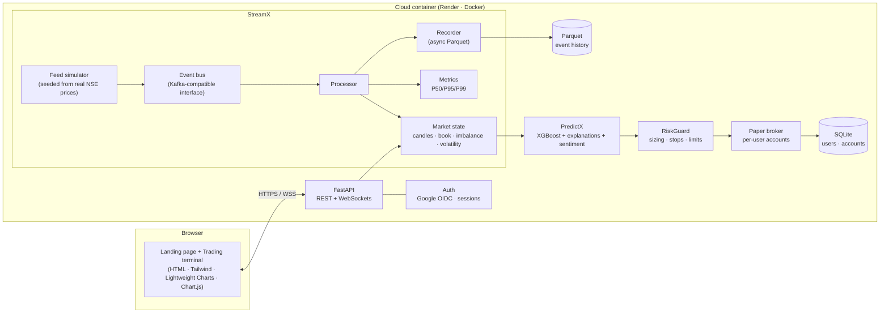
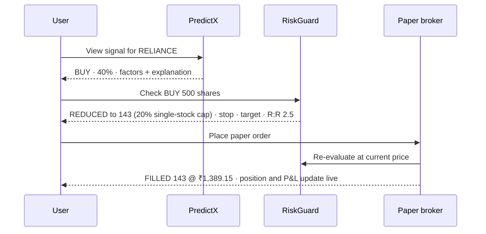

<div align="center">


# TradeMind AI

### A cloud-native platform for AI market intelligence and risk-aware paper trading

**See the market. Understand it. Trade it, risk-free.**

[](https://trademind-ai-ujm6.onrender.com)


</div>

---

## Overview

Retail traders face a constant flood of prices, order-book changes and news. They get little help interpreting it, have weak risk discipline, and have no safe place to try ideas before risking real money.

**TradeMind AI** addresses this with three engines that work together on one cloud-deployed platform:

| | Engine | Responsibility |
|---|---|---|
| 📡 | **StreamX**: data engine | Ingests a high-frequency tick and 5-level order-book stream, maintains real-time market state, records every event, and measures its own latency down to the microsecond. |
| 🧠 | **PredictX**: AI engine | An XGBoost model trained on real NSE data produces **BUY / SELL / HOLD / NO TRADE** signals, and explains *why* through per-prediction feature contributions. |
| 🛡️ | **RiskGuard**: risk engine | Sizes every position, sets stop-loss and target, enforces exposure and loss limits, and **approves, reduces or rejects** each order with a reason. |

Every user signs in with **Google** (or as a guest) and receives a personal **₹10,00,000 virtual account** to test the signals safely.

> 🎓 Built as a final-year **Cloud Computing + Artificial Intelligence** project. It is an educational research prototype inspired by high-frequency trading architecture, not a real trading system and not financial advice.

---

## ✨ Features

**Market terminal**
- Live candlestick chart (TradingView Lightweight Charts), watchlist, 5-level order book and buy/sell-pressure gauge for all **Nifty 50 blue chips** (51 tickers, searchable)
- Real NSE history (5-minute bars) continued by a live simulated feed, clearly labelled in the UI

**AI signals**
- Signal, confidence, class probabilities and prediction horizon
- Top contributing factors with plain-English explanations (for example, *"RSI is 84 (overbought), which supports SELL"*)
- Order-book pressure and news-sentiment blend, plus a NO TRADE gate for low-confidence setups
- Transparent model card: macro-F1, accuracy vs baselines, confusion matrix, feature importance

**Risk-aware paper trading**
- Two-step order ticket: **① Check with RiskGuard → ② Place paper order**
- "Use suggested size" (1% risk position sizing)
- Fills at the live bid/ask; positions, realised and unrealised P&L, equity curve, one-click close
- Order log records the AI signal and RiskGuard verdict for every order, including rejected ones

**Observability**
- StreamX Monitor: events/sec, P50 / P95 / P99 latency, latency histogram, queue depth, recorder status
- Adjustable feed rate (10 to 5,000 events/sec) to load-test the pipeline live

**Platform**
- Google Sign-In (OpenID Connect ID-token verification on the server) and guest mode
- Per-user persistent paper accounts
- Responsive design with a landing page and a six-screen terminal, usable on desktop and phone
- Single Docker image, deployed on Render with auto-deploy from GitHub

---

## 🏗️ Architecture



### From tick to trade



### Prototype → production cloud mapping

| Prototype component | Production cloud equivalent |
|---|---|
| In-process asyncio event bus | Apache Kafka / AWS MSK |
| Parquet event files | Amazon S3 data lake |
| SQLite (users, accounts) | Amazon RDS PostgreSQL |
| In-memory market state | Redis / ElastiCache |
| Docker container on Render | ECS / App Runner / EKS with autoscaling |
| Google Identity Services | OAuth 2.0 / OpenID Connect |

---

## 📊 Results

### Model (held-out test set, real NSE data)

Trained on **~17,000 real 5-minute bars** (4 stocks, late Aug to 23 Nov 2026) using a **time-ordered, purged** train/validation/test split, so the model never sees the future.

| Metric | TradeMind | Baseline |
|---|---|---|
| **Macro-F1** (balanced across classes) | **0.390** | 0.248 (always HOLD) |
| **BUY/SELL hit-rate** | **25.6%** | 20.3% (chance) |
| Confident-signal precision | **29.5%** | 20.3% (chance) |
| Accuracy | 43.8% | 59.3% (always HOLD) · 43.5% (random) |

> 📌 HOLD makes up 59% of bars, so plain accuracy rewards a model that never trades. The model uses balanced class weights and is judged on macro-F1 and directional hit-rate. It shows a **modest, honest edge**. Short-horizon prediction is noisy, which is exactly why RiskGuard sits between every signal and every order.

### System performance (measured)

| Environment | Load | P50 processing | P99 processing |
|---|---|---|---|
| Render (free tier) | 200 events/s | **8.4 µs** | 26.4 µs |
| Laptop (Windows) | 200 events/s | 18 µs | 250 µs |
| Laptop (Windows) | 3,000 events/s | **9.5 µs** | 71 µs |

### Quality

- ✅ **18 unit tests**: risk rules, feature look-ahead safety, broker P&L arithmetic
- ✅ **116 end-to-end checks**, passing locally and in production: routes, auth and session security, input validation, a full trade lifecycle with P&L reconciliation, account isolation, WebSockets

See [`docs/06_Test_Report.md`](docs/06_Test_Report.md).

---

## 🚀 Getting started

### Prerequisites
Python 3.11 · Git · (optional) Node.js, only needed to rebuild the CSS

### Run locally (Windows)

```powershell
git clone https://github.com/rohan911438/TradeMind-AI.git
cd TradeMind-AI
.\run.bat
```

`run.bat` creates the virtual environment, installs dependencies, trains the model if needed, and opens **http://localhost:8000**.

<details>
<summary>Manual setup (any OS)</summary>

```bash
cd backend
python -m venv .venv
# Windows: .venv\Scripts\activate    macOS/Linux: source .venv/bin/activate
pip install -r requirements.txt
python -m app.predictx.train            # optional; a trained model is included
uvicorn app.main:app --port 8000
```
</details>

### Enable Google Sign-In

1. Google Cloud Console → **APIs & Services → Credentials → Create OAuth client ID → Web application**
2. Add **Authorised JavaScript origins**: `http://localhost:8000` and your deployed URL
3. Copy `backend/.env.example` to `backend/.env` and set `GOOGLE_CLIENT_ID=...`

Without a Client ID, the app offers **Continue as guest**.

### Useful commands

| Task | Command (from `backend/`) |
|---|---|
| Unit tests | `python -m pytest -q` |
| End-to-end checks | `python -m scripts.e2e_check [base_url]` |
| Retrain model (fresh data) | `python -m app.predictx.train --refresh` |
| Rebuild CSS (repo root) | `npx tailwindcss@3.4.5 -c tools/tailwind/tailwind.config.js -i tools/tailwind/input.css -o backend/static/css/tw.css --minify` |

---

## ☁️ Deployment

The app ships as a single Docker image (`Dockerfile`), and every push to `main` redeploys it on Render automatically.

| Setting | Value |
|---|---|
| Runtime | Docker (Python 3.11-slim, non-root user) |
| Health check | `/api/health` |
| Environment | `GOOGLE_CLIENT_ID`, `SECRET_KEY`, `HTTPS_ONLY=true` |

See [`docs/07_Deployment_Guide.md`](docs/07_Deployment_Guide.md) for Render and AWS EC2 instructions.

---

## 🗂️ Project structure

```
TradeMind-AI/
├── backend/
│   ├── app/
│   │   ├── main.py            # FastAPI app: REST, WebSockets, auth, static frontend
│   │   ├── auth.py            # Google ID-token verification, guest sessions
│   │   ├── db.py              # SQLite persistence (users, accounts)
│   │   ├── streamx/           # simulator · bus · processor · state · metrics · recorder
│   │   ├── predictx/          # data · features · train · model (inference + explain) · sentiment
│   │   ├── riskguard/         # rule engine
│   │   └── paper/             # paper broker and accounts
│   ├── models/                # trained XGBoost model + metrics.json
│   ├── data/raw/              # cached NSE 5-minute bars
│   ├── static/                # landing page + trading terminal
│   ├── scripts/e2e_check.py   # end-to-end product checks
│   └── tests/                 # unit tests
├── docs/                      # synopsis, SRS, architecture, demo guide, test report, deployment
├── Dockerfile
└── run.bat
```

---

## 📚 Documentation

| Document | Contents |
|---|---|
| [Project Synopsis](docs/01_Project_Synopsis.md) | Abstract, problem, objectives, methodology, results, limitations |
| [Requirements (SRS)](docs/02_SRS.md) | Functional and non-functional requirements with implementation status |
| [System Architecture](docs/03_System_Architecture.md) | Components, data flow, schemas, API reference, algorithms |
| [Demo Guide & Viva Prep](docs/04_Demo_Scope_and_Plan.md) | 7-minute demo script and likely questions |
| [Development Log](docs/05_Prompt_Sequence.md) | How it was built, plus prompts for extending it |
| [Test Report](docs/06_Test_Report.md) | Test strategy, results, bugs found and fixed |
| [Deployment Guide](docs/07_Deployment_Guide.md) | Render, Docker and AWS EC2 deployment |
| **[Project Thesis](thesis/main.md)** | Full B.Tech report (also as `.docx`) with 7 reproducible benchmarks: capture, persistence, load, model, trading with costs, decision latency, cloud |

---

## ⚖️ Honest scope & limitations

- **Simulated live feed.** No free real-time NSE tick feed exists, so StreamX continues real price history with a calibrated simulator. One live candle stands for one 5-minute bar, compressed to 10 seconds. A real broker feed plugs into the same event-bus interface.
- **Modest model edge.** The results above are real held-out numbers, not cherry-picked. Model confidence is **not** a probability of profit.
- **Sample sentiment.** News sentiment uses illustrative sample headlines and a finance lexicon. FinBERT on live news is future work.
- **Free-tier hosting.** The demo sleeps after 15 minutes of inactivity (the first load takes about a minute), and paper accounts reset when the service restarts.

## 🛣️ Roadmap

- [ ] FinBERT sentiment on a live news API
- [ ] LSTM / Transformer sequence models
- [ ] Kafka (AWS MSK) and horizontal processor scaling
- [ ] PostgreSQL / TimescaleDB and an S3 data lake
- [ ] Historical replay and a strategy back-testing library
- [ ] Broker API integration for real market data

---

<div align="center">

**TradeMind AI** · Cloud Computing + AI final project

<sub>Educational prototype. Not financial advice. No real money is ever traded.</sub>

</div>
