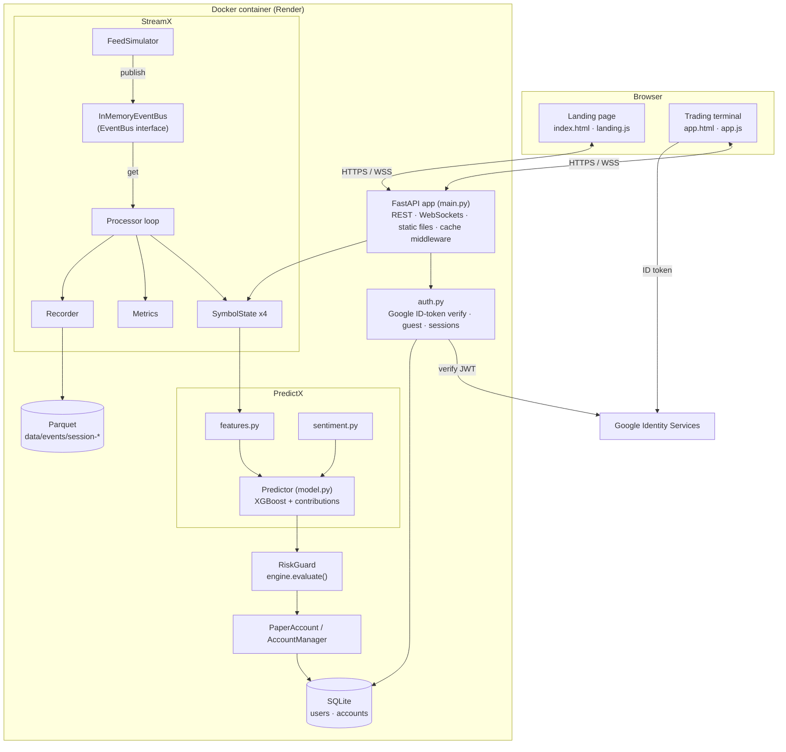
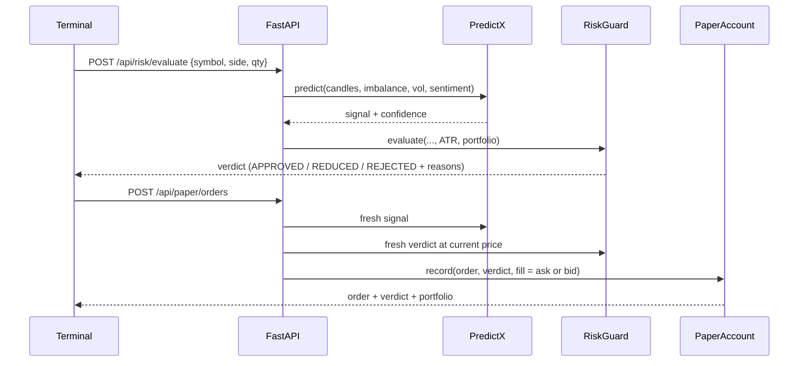

# System Architecture & Design

This document describes TradeMind AI **as built and deployed**.

## 1. High-Level Architecture



### Cloud mapping

| Prototype | Production equivalent | Why it maps cleanly |
|---|---|---|
| `InMemoryEventBus` (asyncio queue) | Apache Kafka / AWS MSK | Same `publish`/`get` interface; partition by symbol |
| Parquet files | Amazon S3 data lake | Same columnar format; Athena/Spark-ready |
| SQLite | Amazon RDS PostgreSQL | Small SQL schema, swap the connection |
| `SymbolState` in memory | Redis / ElastiCache | Key-value snapshot per symbol |
| Single Docker container | ECS / App Runner / EKS | Stateless API plus environment config |
| Session cookie + Google OIDC | Same, behind a load balancer | Signed cookies need no server-side session store |

## 2. Data Flow

### 2.1 One market event
1. `FeedSimulator.run()` wakes every ~10 ms. It computes how many events are due from **real elapsed time** (rate × Δt), because asyncio sleep is imprecise on Windows. It creates each `MarketEvent` with `created_ns = perf_counter_ns()` and publishes it to the bus.
2. The processor takes the event, sets `ingest_ns`, and calls `SymbolState.update()`. That updates price, book, imbalance and the current candle, and rolls to a new candle every `BAR_SECONDS` (10 s). The processor then sets `processed_ns`.
3. `Metrics.observe()` stores *processing* latency (processed − ingest) and *end-to-end* latency (processed − created) in 10,000-slot ring buffers. Percentiles are computed once per second.
4. `Recorder.add()` buffers the event. Every 5 s (or 20,000 events) a batch is written to Parquet in a background thread.
5. `/ws/market` sends a snapshot of all four symbols every 250 ms; `/ws/monitor` sends metrics every second.

### 2.2 One paper order

An order is **always re-evaluated at submit time**, so a stale check can never bypass the risk limits.

## 3. Repository Layout

```
TradeMind-AI/
├── Dockerfile · .dockerignore · run.bat · README.md · CLAUDE.md
├── backend/
│   ├── requirements.txt · .env.example
│   ├── app/
│   │   ├── main.py              # app, routes, websockets, cache middleware, static mount
│   │   ├── config.py            # Settings (env + backend/.env), paths, DISCLAIMER
│   │   ├── auth.py              # verify_google_token, guest_user, current_user dependency
│   │   ├── db.py                # SQLite: users, accounts (JSON state)
│   │   ├── streamx/  events · bus · simulator · state · metrics · recorder · engine
│   │   ├── predictx/ data · features · train · model · sentiment
│   │   ├── riskguard/engine.py
│   │   └── paper/broker.py
│   ├── models/                  # xgb_model.json, metrics.json
│   ├── data/raw/                # <SYMBOL>_5m.csv, sources.json
│   ├── static/                  # index.html, app.html, css/{tw,theme}.css, js/, vendor/, img/
│   ├── scripts/e2e_check.py
│   └── tests/                   # test_riskguard.py, test_features_broker.py
├── tools/tailwind/              # Tailwind build config
└── docs/
```

## 4. Core Data Structures

### MarketEvent (`streamx/events.py`)
```python
@dataclass(slots=True)
class MarketEvent:
    seq: int; symbol: str; type: str          # "TRADE"
    price: float; qty: int
    bids: list[tuple[float, int]]             # 5 levels, best first
    asks: list[tuple[float, int]]
    created_ns: int; ingest_ns: int; processed_ns: int   # time.perf_counter_ns()
```

### Signal (`GET /api/predict/{symbol}`)
```json
{
  "symbol": "RELIANCE", "signal": "NO_TRADE", "model_view": "SELL",
  "confidence": 0.3203, "raw_confidence": 0.3703, "threshold": 0.3513,
  "probabilities": {"SELL": 0.3703, "HOLD": 0.3021, "BUY": 0.3276},
  "market_pressure": "Positive", "imbalance": 0.53,
  "sentiment": {"score": 0.5, "label": "Positive"},
  "annualised_volatility": 0.187,
  "top_factors": [{"feature": "atr_pct", "value": 0.0032, "contribution": 0.217,
                   "text": "Average true range is 0.32% of price, which supports SELL"}],
  "explanation": "The model leans SELL (37% raw probability) mainly because ...",
  "horizon": "next 6 bars (~30 simulated minutes)", "model_version": "xgb-20261123-2022",
  "disclaimer": "Educational prototype. Confidence is not a probability of profit. Not financial advice."
}
```

### RiskVerdict (`POST /api/risk/evaluate`)
```json
{
  "status": "REDUCED", "symbol": "RELIANCE", "side": "BUY",
  "requested_qty": 144, "approved_qty": 143, "entry": 1389.15,
  "stop_loss": 1382.55, "target": 1405.92, "risk_reward": 2.54, "risk_amount": 944.0,
  "annualised_volatility": 0.21, "risk_level": "MODERATE",
  "exposure_symbol_after": 0.199, "exposure_total_after": 0.199,
  "signal": "BUY", "confidence": 0.41,
  "reasons": ["Quantity reduced from 144 to 143: limited by single-stock cap (20%)",
              "Stop 1382.55 (1.5x ATR), target 1405.92, R:R 2.54"]
}
```

### Persistence (`db.py`)
| Table | Columns |
|---|---|
| `users` | `id` (`google:<sub>` or `guest:<hex>`), email, name, picture, provider, created_at, last_login |
| `accounts` | `user_id`, `state_json` (cash, positions, realised P&L by day, orders, equity curve), updated_at |

## 5. API Reference

| Method | Path | Auth | Description |
|---|---|---|---|
| GET | `/api/health` | – | Status, feed mode, data sources, model loaded |
| GET | `/api/symbols` | – | Watchlist summary |
| GET | `/api/market/{symbol}/snapshot` | – | Book, prices, imbalance, volatility |
| GET | `/api/market/{symbol}/candles?limit=400` | – | Historical + live candles |
| GET | `/api/predict/{symbol}` | – | AI signal |
| GET | `/api/predict/model-info` | – | Model card (metrics.json) |
| GET | `/api/sentiment/{symbol}` | – | Sentiment score + headlines |
| GET | `/api/auth/config` | – | Google client id, guest flag |
| POST | `/api/auth/google` | – | `{credential}` → verify ID token, start session |
| POST | `/api/auth/guest` | – | Start guest session |
| GET | `/api/auth/me` | ✔ | Current user |
| POST | `/api/auth/logout` | – | Clear session |
| POST | `/api/risk/evaluate` | ✔ | `{symbol, side, qty?}` → verdict + signal |
| GET | `/api/risk/portfolio` | ✔ | Exposure, per-stock risk, limits, daily loss used |
| POST | `/api/paper/orders` | ✔ | `{symbol, side, qty?}` → order + verdict + portfolio |
| GET | `/api/paper/portfolio` | ✔ | Cash, equity, positions, P&L |
| GET | `/api/paper/orders` | ✔ | Last 100 orders |
| GET | `/api/paper/equity` | ✔ | Equity curve |
| POST | `/api/paper/reset` | ✔ | Reset to ₹10,00,000 |
| GET | `/api/monitor/metrics` | – | Throughput, latency, histogram, recorder |
| POST | `/api/monitor/rate` | – | `{events_per_sec: 1..20000}` |
| WS | `/ws/market` | – | Snapshots every 250 ms |
| WS | `/ws/monitor` | – | Metrics every 1 s |
| GET | `/docs` | – | Interactive OpenAPI (Swagger) |

Validation errors return **422**, unknown symbols **404**, and missing sessions **401**.

## 6. Key Algorithms

**Price process.** `p ← p · exp(regime · 0.35σ_bar · Δb + σ_bar · √Δb · Z)`, where Δb = elapsed real time / `BAR_SECONDS` and σ_bar = daily volatility / √75. The regime drifts toward a random target that changes about every 5 bars and skews book quantities by ±70%.

**Labels.** `fwd = close[t+6]/close[t] − 1` → BUY if > +0.25%, SELL if < −0.25%, otherwise HOLD.

**Explanation.** `booster.predict(DMatrix, pred_contribs=True)` gives a contribution per feature and class. The top four by |value| for the predicted class are turned into sentences by templates.

**Confidence blend.** +0.04 if book pressure agrees with the direction, −0.05 if it disagrees, +0.02 if sentiment agrees. NO TRADE if the result is below the threshold (validation median, 0.351) or volatility is above 80%.

**Risk.**
- stop distance = max(1.5 × ATR, 0.2% × entry)
- reward multiple = clip(1.5 + 30 × (confidence − 1/3), 1, 4.5)
- R:R = reward multiple / 1.5, rejected below 1.2
- qty = min(⌊0.01 × equity / stop distance⌋, single-stock room, total room, cash) / entry

**Latency percentiles.** `numpy.percentile` over the last 10,000 samples, computed once per second.

## 7. Security Design
- Google ID tokens are verified on the server with `google.oauth2.id_token.verify_oauth2_token` (signature, `aud` = our Client ID, expiry), and the email must be verified.
- Sessions are signed (`itsdangerous`) HTTP-only cookies with `SameSite=Lax`, plus `Secure` when `HTTPS_ONLY=true`.
- The secret key comes from the `SECRET_KEY` environment variable (or a generated file that is git-ignored).
- No secrets are in the repository: `.env`, the database and the secret key are ignored.
- The container runs as a non-root user.

## 8. Design Decisions

| Decision | Reason |
|---|---|
| Vanilla JS + precompiled Tailwind instead of React | No build step and a fast, demo-safe delivery; the Tailwind runtime froze the UI under live updates |
| In-process event bus behind an interface | Zero infrastructure for the prototype, with a clean path to Kafka |
| `perf_counter_ns` for latency | `time.time_ns` only ticks about once a millisecond on Windows |
| Rate pacing by elapsed time | asyncio sleep granularity on Windows made the feed run at about 40× its target |
| XGBoost over deep learning | Tabular features, small data, fast training, built-in explanations |
| Re-run the risk check at order submit | Prevents placing an order on a stale approval |
| `Cache-Control: no-cache` on app files | Users get new deploys immediately (cheap 304 revalidation) |
