<div align="center">

# TRADEMIND AI

## A CLOUD-BASED INTELLIGENT TRADING AND HIGH-FREQUENCY MARKET INTELLIGENCE PLATFORM

*A Project Report*

submitted in partial fulfilment of the requirements for the award of the degree of

**BACHELOR OF TECHNOLOGY**
in
**INFORMATION TECHNOLOGY**

by

**[STUDENT NAME 1]** ([ROLL NUMBER])
**[STUDENT NAME 2]** ([ROLL NUMBER])
**[STUDENT NAME 3]** ([ROLL NUMBER])

Under the guidance of
**[NAME OF SUPERVISOR]**
[Designation], Department of Information Technology

**Government College of Engineering & Ceramic Technology**
(An Autonomous Institution under MAKAUT)
Kolkata – 700010

**[ACADEMIC YEAR]**

Live system: https://trademind-ai-ujm6.onrender.com · Source code: https://github.com/rohan911438/TradeMind-AI (release v1.0.0)

</div>

<div style="page-break-after: always;"></div>

## BONAFIDE CERTIFICATE

> *Use the exact specimen given in the GCECT B.Tech Project Report Format. The text below follows that specimen's usual wording; replace it with the official version if it differs.*

This is to certify that the project report entitled **"TradeMind AI: A Cloud-Based Intelligent Trading and High-Frequency Market Intelligence Platform"** is the bonafide work of **[STUDENT NAME 1] ([ROLL NUMBER]), [STUDENT NAME 2] ([ROLL NUMBER]) and [STUDENT NAME 3] ([ROLL NUMBER])**, who carried out the project work under my supervision in partial fulfilment of the requirements for the award of the degree of Bachelor of Technology in Information Technology of Government College of Engineering & Ceramic Technology, Kolkata, during the academic year [ACADEMIC YEAR].

| | | |
|---|---|---|
| **[NAME OF SUPERVISOR]** | **[NAME OF HOD]** | **External Examiner** |
| Supervisor, [Designation] | Head of the Department | |
| Department of Information Technology | Department of Information Technology | |
| Signature and date: | Signature and date: | Signature and date: |

<div style="page-break-after: always;"></div>

## DECLARATION

We declare that the project report entitled **"TradeMind AI: A Cloud-Based Intelligent Trading and High-Frequency Market Intelligence Platform"**, submitted in partial fulfilment of the requirements for the degree of Bachelor of Technology in Information Technology, is a record of work carried out by us under the supervision of **[NAME OF SUPERVISOR]**. This work has not been submitted, in whole or in part, for any other degree or diploma. All external sources, research contributions, software libraries and datasets used in this report have been acknowledged.

We further declare that every performance figure, model metric and trading-simulation result in this report was produced by the scripts in the `thesis/benchmarks/` folder of the project repository, on the hardware described in Section 8.2, and can be reproduced with those scripts.

| Name | Roll number | Signature |
|---|---|---|
| [STUDENT NAME 1] | [ROLL NUMBER] | |
| [STUDENT NAME 2] | [ROLL NUMBER] | |
| [STUDENT NAME 3] | [ROLL NUMBER] | |

Place: Kolkata    Date: [DATE]

<div style="page-break-after: always;"></div>

## ACKNOWLEDGEMENT

We express our sincere gratitude to our project supervisor, **[NAME OF SUPERVISOR]**, for guidance on the scope, design and evaluation of this work, and in particular for insisting that every claim be supported by a measurement. We thank **[NAME OF HOD]**, Head of the Department of Information Technology, and the faculty members of the department for their support and for the facilities provided. We are grateful to Government College of Engineering & Ceramic Technology for the opportunity to undertake this project.

We acknowledge the open-source communities behind Python, FastAPI, XGBoost, scikit-learn, pandas, Apache Arrow, TradingView Lightweight Charts and Chart.js, on which this system is built, and Yahoo Finance, whose public historical data (accessed through the `yfinance` library) made the model training possible.

*[Edit this acknowledgement so that it thanks only the people and organisations who actually contributed.]*

<div style="page-break-after: always;"></div>

## ABSTRACT

Financial markets generate continuous streams of trades, quotes, order-book updates and news. Turning this stream into useful decisions needs four things: reliable event capture, timely processing, an analytical model that is honest about its accuracy, and disciplined risk control. This project designs, implements, deploys and evaluates **TradeMind AI**, a cloud-based trading decision-support prototype built from three cooperating engines.

**StreamX** is the market-data engine. It ingests a five-level order-book and trade stream for four NSE equities (RELIANCE, TCS, INFY, HDFCBANK) and stamps each event at three points with a monotonic nanosecond clock. It maintains in-memory market state (candles, best bid and offer, depth, order-book imbalance, volatility) and records every event to Parquet files through an asynchronous, batched writer. Because no free real-time NSE tick feed exists, the live stream is produced by a stochastic simulator seeded from real NSE prices and volatilities, and the system labels it as simulated. **PredictX** is the AI engine. It is a gradient-boosted tree model (XGBoost) trained on about 17,000 real 5-minute NSE bars, using ten look-ahead-free technical features and a purged chronological train/validation/test split. It produces BUY, SELL, HOLD or NO TRADE signals with per-prediction explanations derived from tree contributions. **RiskGuard** is a deterministic rule engine. It sizes each position by a 1% risk budget and an ATR-based stop, enforces risk/reward, single-stock, total-exposure and daily-loss limits, and returns APPROVED, REDUCED or REJECTED with human-readable reasons. A paper-trading broker gives every Google-authenticated user a ₹10,00,000 virtual account. The system is packaged as a single Docker image and runs on the Render cloud platform with continuous deployment from GitHub.

Seven experiments evaluate the system:
- **Capture.** Fixed-interval snapshots of the same stream hide 80–98% of events at a 100 ms interval, depending on the event rate.
- **Persistence.** Asynchronous Parquet persistence keeps the processing path at a P99 of 65 µs at 1,000 events/s, while synchronous SQLite with full durability collapses throughput to about 60 events/s.
- **Load.** On a two-core laptop, StreamX sustains its target rate up to 5,000 events/s, with P99 state-update latency of 29 µs and no data loss. It saturates at about 8,500–8,800 events/s, where a single CPU core is fully used.
- **Model accuracy.** On the held-out period (5–23 November 2026), XGBoost achieves a macro-F1 of 0.390 against 0.248 for the majority-class baseline, and a directional hit-rate of 25.6% against 20.3% chance. Logistic regression performs about as well (0.391), which shows that the available signal is weak and mostly linear.
- **Trading simulation.** Without costs, XGBoost signals combined with RiskGuard returned +2.43% with a maximum drawdown of −0.53%. At a realistic 10 bps round-trip cost, every active strategy lost money, while buy-and-hold gained +1.50%.

The project's contribution is a complete, measured and reproducible data-to-decision pipeline, together with an honest account of where it works and where it does not. It does not claim exchange-grade latency or a profitable trading strategy.

**Keywords:** Cloud Computing, Event Streaming, High-Frequency Market Data, Limit Order Book, Order-Book Imbalance, Machine Learning, XGBoost, Explainable AI, Risk Management, Paper Trading, Latency Measurement.

<div style="page-break-after: always;"></div>

## TABLE OF CONTENTS

> *Generate the final table of contents automatically in Word (References → Table of Contents) after pagination is final. The list below is the heading structure.*

- Bonafide Certificate · Declaration · Acknowledgement · Abstract
- List of Figures · List of Tables · List of Abbreviations and Symbols
- **Chapter 1: Introduction**: 1.1 General · 1.2 Background · 1.3 Motivation · 1.4 Project Overview · 1.5 Problem Statement · 1.6 Contributions · 1.7 Organisation of the Report
- **Chapter 2: Literature Review**: 2.1 Introduction · 2.2 HFT and Market Design · 2.3 Empirical Latency Races · 2.4 Deep Learning for Limit Order Books · 2.5 Gradient Boosting · 2.6 Cloud Low-Latency Architecture · 2.7 Event Streaming and Storage · 2.8 Indian Market-Data Context · 2.9 Comparative Table · 2.10 Research Gap · 2.11 Summary
- **Chapter 3: Problem Definition, Objectives and Requirements**: 3.1 Existing Systems · 3.2 Proposed System · 3.3 Objectives · 3.4 Scope · 3.5 Functional Requirements · 3.6 Non-Functional Requirements · 3.7 Feasibility · 3.8 Assumptions and Constraints
- **Chapter 4: Theoretical Foundations**: 4.1 Market Data Events · 4.2 Sampling vs Event Capture · 4.3 Limit Order Book · 4.4 Order-Book Imbalance · 4.5 Returns and Volatility · 4.6 Technical Indicators · 4.7 Gradient-Boosted Trees · 4.8 Classification Metrics · 4.9 Sentiment Analysis · 4.10 Risk Measures · 4.11 Latency Metrics · 4.12 Summary
- **Chapter 5: System Architecture and Design**: 5.1 Overview · 5.2 StreamX · 5.3 PredictX · 5.4 RiskGuard · 5.5 Paper Broker · 5.6 Storage · 5.7 Event Schema · 5.8 Database Design · 5.9 API Design · 5.10 Security and Reliability · 5.11 Cloud Mapping
- **Chapter 6: Methodology and Algorithms**: 6.1 Overall Methodology · 6.2 Dataset · 6.3 Simulator · 6.4 Preprocessing · 6.5 Features · 6.6 Target · 6.7 Model Development · 6.8 Evaluation Protocol · 6.9 Stream Processing Algorithm · 6.10 Risk Algorithm · 6.11 Trading Simulation
- **Chapter 7: Implementation**: 7.1 Environment · 7.2 Repository Structure · 7.3 Backend and API · 7.4 StreamX · 7.5 PredictX · 7.6 RiskGuard and Paper Trading · 7.7 Authentication · 7.8 Frontend · 7.9 Cloud Deployment · 7.10 Error Handling and Logging · 7.11 Testing
- **Chapter 8: Experimental Setup, Testing and Results**: 8.1 Objectives · 8.2 Test Environment · 8.3 Workload Design · 8.4 Metrics · 8.5 Experiment A: Capture Interval · 8.6 Experiment B: Persistence · 8.7 Experiment C: Load and Scalability · 8.8 Experiment D: Model Evaluation · 8.9 Experiment E: Trading Simulation · 8.10 Experiment F: Decision-Path Latency · 8.11 Experiment G: Cloud Deployment · 8.12 Functional Testing · 8.13 Summary
- **Chapter 9: Discussion, Limitations and Security**
- **Chapter 10: Conclusion and Future Scope**
- Appendices 1–7 · References

<div style="page-break-after: always;"></div>

## LIST OF FIGURES

| Figure | Title |
|---|---|
| 5.1 | High-level architecture of TradeMind AI |
| 5.2 | Sequence of a paper order (signal → risk check → fill) |
| 5.3 | StreamX event pipeline and timestamp points |
| 8.1 | Events hidden by fixed-interval sampling; price movement between snapshots |
| 8.2 | Persistence strategies: P99 latency at 1,000 events/s and maximum throughput |
| 8.3 | Throughput: target vs achieved feed rate |
| 8.4 | StreamX processing latency (P50/P95/P99) under load |
| 8.5 | End-to-end latency under load |
| 8.6 | Process CPU utilisation under load |
| 8.7 | Model comparison (macro-F1) on the held-out test period |
| 8.8 | XGBoost confusion matrix |
| 8.9 | XGBoost feature importance |
| 8.10 | Reliability (calibration) of model confidence |
| 8.11 | Equity curves on the test period at 10 bps round-trip cost |
| 8.12 | Sensitivity of strategy returns to transaction costs |
| 8.13 | Client-observed API latency: local vs Render cloud |

## LIST OF TABLES

| Table | Title |
|---|---|
| 2.1 | Comparative literature table |
| 3.1 | Functional requirements and implementation status |
| 3.2 | Non-functional requirements, targets and measured values |
| 5.1 | Normalised market-event schema |
| 5.2 | Database entities |
| 5.3 | REST and WebSocket API |
| 5.4 | Prototype-to-production cloud mapping |
| 6.1 | Dataset description |
| 6.2 | Feature definitions |
| 6.3 | RiskGuard rules and parameters |
| 8.1 | Test environment |
| 8.2 | Performance metric definitions |
| 8.3 | Experiment A: capture-interval results |
| 8.4 | Experiment B: persistence strategy at 1,000 events/s |
| 8.5 | Experiment B: maximum processing throughput |
| 8.6 | Experiment C: load and scalability (mean of 3 trials) |
| 8.7 | Experiment D: model results on the test set |
| 8.8 | Experiment D: XGBoost per-symbol results |
| 8.9 | Experiment D: confidence calibration |
| 8.10 | Experiment E: trading simulation by cost level |
| 8.11 | Experiment F: decision-path latency |
| 8.12 | Experiment G: API latency, local vs cloud |
| 8.13 | Functional test summary |

## LIST OF ABBREVIATIONS AND SYMBOLS

| Term | Meaning |
|---|---|
| AI | Artificial Intelligence |
| API | Application Programming Interface |
| ATR | Average True Range |
| AWS | Amazon Web Services |
| BBO | Best Bid and Offer |
| bps | Basis points (1 bps = 0.01%) |
| CNN | Convolutional Neural Network |
| CVD | Colour-Vision Deficiency |
| ECE | Expected Calibration Error |
| EMA | Exponential Moving Average |
| HFT | High-Frequency Trading |
| JWT | JSON Web Token |
| LOB | Limit Order Book |
| LSTM | Long Short-Term Memory network |
| MACD | Moving Average Convergence Divergence |
| MDD | Maximum Drawdown |
| ML | Machine Learning |
| NSE | National Stock Exchange of India |
| OBI | Order-Book Imbalance |
| OHLCV | Open, High, Low, Close, Volume |
| OIDC | OpenID Connect |
| P50 / P95 / P99 | 50th / 95th / 99th percentile (of latency) |
| R:R | Reward-to-risk ratio |
| REST | Representational State Transfer |
| RSI | Relative Strength Index |
| S3 | Amazon Simple Storage Service |
| SHAP | SHapley Additive exPlanations |
| WAL | Write-Ahead Logging (SQLite journal mode) |
| WS / WSS | WebSocket / WebSocket over TLS |
| events/s | Market events per second (the throughput unit used throughout this report) |
| µs, ms | Microsecond (10⁻⁶ s), millisecond (10⁻³ s) |
| H | Prediction horizon in bars (H = 6) |
| θ | Label threshold on forward return (θ = 0.25%) |
| Q_bid, Q_ask | Total displayed bid / ask quantity over the top 5 levels |

<div style="page-break-after: always;"></div>

# CHAPTER 1: INTRODUCTION

## 1.1 General

Electronic financial markets produce a continuous flow of information. Market participants observe prices, quantities, trades, bid and ask quotations, order-book depth and public news to form trading decisions. The volume and rate of these events make market-data engineering a central part of modern financial technology. A system that stores only occasional price snapshots may be sufficient for a basic charting application, but it does not preserve the sequence of short-lived changes contained in the underlying event stream.

## 1.2 Background

A **quote** is the price and quantity currently offered by buyers (bids) and sellers (asks). A **limit order book** organises resting buy and sell orders by price level. Trades, additions, modifications and cancellations all change the book. **Tick data** refers to event-level observations, whereas **fixed-interval sampling** records one value per chosen interval. These are not interchangeable: a 100-millisecond snapshot captures one state per interval, while an event feed may contain many updates within that interval. Experiment A (Section 8.5) measures exactly how much is lost.

**High-frequency trading (HFT)** describes systems that process market information and manage orders at very short time scales. Published research documents latency races measured in microseconds in some markets [2]. This project does not attempt to reproduce institutional HFT infrastructure such as colocation, kernel-bypass networking or FPGA hardware. Instead, it studies the underlying data-engineering principles in a controlled, cloud-deployed prototype and measures them carefully.

## 1.3 Motivation

The project sits where three areas meet:

1. **Continuous market-data engineering:** capturing, timestamping, processing and storing a high-rate event stream without blocking.
2. **AI-assisted interpretation:** turning indicators and order-book state into signals a learner can understand, with explanations and honest accuracy figures.
3. **Risk-aware decision support:** making sure a prediction never becomes a trade without position sizing, stop-losses and exposure limits.

A useful educational platform should show not only a predictive model but also how data is acquired, timestamped, transformed, stored, evaluated and presented, and what each of those steps costs in time.

## 1.4 Project Overview

TradeMind AI is a cloud-deployed trading intelligence platform with three engines and a paper-trading layer:

- **StreamX (market-data engine):** event ingestion, timestamping, in-memory market state, order-book analytics, asynchronous Parquet recording and live latency metrics.
- **PredictX (AI engine):** an XGBoost classifier trained on real NSE 5-minute data, producing BUY / SELL / HOLD / NO TRADE signals with per-prediction explanations, blended with order-book pressure and sample-headline sentiment.
- **RiskGuard (risk engine):** a deterministic rule engine for position sizing, stop-loss, risk/reward and exposure limits that approves, reduces or rejects every simulated order with stated reasons.
- **Paper broker and web terminal:** Google sign-in, a ₹10,00,000 virtual account per user, live charts, an order ticket, a portfolio view and a StreamX performance monitor.

The system is live at https://trademind-ai-ujm6.onrender.com and its source code is public at https://github.com/rohan911438/TradeMind-AI.

## 1.5 Problem Statement

> To design, implement and evaluate a modular, cloud-deployed prototype that ingests timestamped market events, processes them into market features, applies machine learning to produce explainable trading signals, and provides risk-aware decision support through a simulated trading environment, while measuring processing performance, data integrity, predictive value and simulated trading outcomes against appropriate baselines.

## 1.6 Contributions

1. A working, publicly deployed system integrating event processing, explainable ML signals, deterministic risk control, paper trading and Google authentication (Chapters 5 and 7).
2. A latency instrumentation design with three monotonic nanosecond timestamps per event, separating state-update, processing-path and end-to-end latency (Sections 4.11 and 5.2).
3. A reproducible benchmark suite of seven experiments, with all scripts and raw results in the repository (Chapter 8, Appendix 4).
4. An honest model and strategy evaluation against six baselines and four transaction-cost levels. It shows a modest statistical edge that does not survive realistic costs (Sections 8.8–8.9).

## 1.7 Organisation of the Report

- **Chapter 2** reviews the literature on market design, latency races, order-book learning, gradient boosting, cloud architecture and event streaming.
- **Chapter 3** defines the problem, objectives, scope and requirements.
- **Chapter 4** presents the theoretical foundations.
- **Chapter 5** describes the architecture and design.
- **Chapter 6** gives the methodology and algorithms.
- **Chapter 7** documents the implementation.
- **Chapter 8** reports the experimental setup and measured results.
- **Chapter 9** discusses findings, limitations and security.
- **Chapter 10** concludes and outlines future work.
- **The appendices** contain the data dictionary, API reference, pseudocode, experiment configuration, screenshots, the team contribution table and the reproduction guide.

<div style="page-break-after: always;"></div>

# CHAPTER 2: LITERATURE REVIEW

## 2.1 Introduction

This chapter reviews research and technical sources on market microstructure, latency competition, limit-order-book prediction, gradient boosting, event-streaming systems and cloud deployment. The aim is to extract design principles that a student-scale prototype can implement and measure, not to claim equivalence with production exchange systems.

## 2.2 High-Frequency Trading and Market Design

Budish, Cramton and Shim [1] analyse the high-frequency trading "arms race" in continuous limit-order-book markets. They argue that continuous serial processing of orders creates mechanical arbitrage opportunities whenever public information changes. These reward pure speed advantages and produce an arms race for ever-smaller latency, and the paper proposes frequent batch auctions as a market-design response. For this project, the key lesson is that latency matters because of *how the market processes events*, which motivates treating the event stream, rather than periodic snapshots, as the primary data. The paper is market-design research, not an implementation guide for a cloud trading application.

## 2.3 Empirical Measurement of Latency Races

Aquilina, Budish and O'Neill [2] use exchange message data from the London Stock Exchange to measure latency-arbitrage races directly. They report that races are extremely frequent and short, with a modal duration of roughly 5–10 microseconds in their FTSE 100 sample, and that a meaningful share of trading volume takes place in races. This shows why latency must be reported with a clearly defined *measurement boundary* (where the clock starts and stops) and as a *distribution*, not an average. TradeMind AI adopts both practices (Section 4.11). Their numbers are specific to that market and dataset and are not generalised here.

## 2.4 Deep Learning for Limit Order Books

Zhang, Zohren and Roberts [3] propose **DeepLOB**, which combines convolutional layers that learn spatial structure across order-book levels with an LSTM that models temporal dependencies, and evaluate it on LOB datasets including FI-2010. Their work motivates using order-book features (such as depth imbalance) rather than daily closing prices alone. It also shows that serious deep LOB models need large volumes of full-depth, event-level data. TradeMind AI does not have licensed full-depth NSE data. It therefore uses a gradient-boosted tree model on bar-level technical features as its principal model, and uses live order-book imbalance only as a documented adjustment to confidence (Section 5.3). A DeepLOB-style model is listed as future work.

## 2.5 Gradient-Boosted Decision Trees

Chen and Guestrin [4] describe **XGBoost**, a scalable tree-boosting system with regularised objectives, sparsity-aware split finding and efficient parallel training. Gradient-boosted trees are widely reported as strong baselines for *tabular* data with engineered features. They are fast to train and evaluate, and they support exact per-prediction feature contributions (TreeSHAP-style), which Lundberg and Lee formalised as SHAP values [5]. These properties suit a project that needs to explain each signal to a learner.

## 2.6 Cloud-Based Low-Latency Architecture

AWS's engineering guidance on tick-to-trade latency [6] describes a pipeline of market-data ingestion, normalisation, signal generation, pre-trade risk checks and order transmission. It recommends keeping hot-path state in memory and moving logging and persistence off the latency-critical path. TradeMind AI applies this directly: StreamX updates in-memory state on the hot path and hands persistence to an asynchronous batched recorder. Experiment B measures the effect of that choice. Vendor guidance is engineering advice rather than independent comparative research, and cloud infrastructure does not by itself guarantee deterministic latency.

## 2.7 Event Streaming and Storage Technologies

Apache Kafka [7] provides distributed, partitioned, replicated logs with producers, topics and consumer groups. It decouples data producers from processors and allows events to be replayed within a retention window. Partitioning by symbol preserves per-symbol ordering while allowing horizontal scaling. For storage, columnar formats such as Apache Parquet [8] compress well and are efficient for analytical scans, and they are the standard layout for object-storage data lakes. For a single-node prototype, a full Kafka cluster adds operational overhead that the workload does not justify. TradeMind AI therefore implements an in-process bus *behind the same publish/consume interface* (Section 5.2), keeping the migration path open.

## 2.8 Indian Market-Data Context

The National Stock Exchange of India offers several real-time data products [9], from Level 1 (best bid and offer) through deeper market-by-price levels to tick-by-tick order-level feeds. They differ in depth, delivery mechanism and licensing terms, and real-time use requires a commercial agreement with the exchange or an authorised vendor. Public sources such as Yahoo Finance provide delayed or historical bars only. This constraint shapes the project's data design: real historical 5-minute bars for training and a calibrated simulator for the live stream (Section 6.3).

## 2.9 Comparative Literature Table

**Table 2.1: Comparative literature table**

| Author / Source | Focus | Key relevance to TradeMind AI | Limitation for this project |
|---|---|---|---|
| Budish, Cramton & Shim (2015) [1] | HFT arms race and market design | Explains why event-level speed matters in continuous markets | Not a systems or cloud implementation paper |
| Aquilina, Budish & O'Neill (2022) [2] | Empirical latency-race measurement | Microsecond races; report distributions with clear boundaries | Market- and dataset-specific findings |
| Zhang, Zohren & Roberts (2019) [3] | Deep learning on limit order books | Order-book structure carries predictive information | Requires licensed full-depth event data |
| Chen & Guestrin (2016) [4] | Gradient-boosted trees (XGBoost) | Strong tabular baseline; fast; per-prediction contributions | Needs engineered features; no sequence memory |
| Lundberg & Lee (2017) [5] | SHAP feature attribution | Principled per-prediction explanations | Contributions explain the model, not the market |
| AWS (2025) [6] | Tick-to-trade architecture | In-memory hot path; asynchronous logging | Vendor guidance, not independent evaluation |
| Apache Kafka docs [7] | Distributed event streaming | Producer/consumer decoupling, replay, partitioning | Operational overhead for small prototypes |
| Apache Parquet [8] | Columnar storage | Compact, analytics-friendly event archive | Not a low-latency query store |
| NSE market-data documentation [9] | Indian exchange data products | Feed types, depth levels and licensing | Commercial access required for live data |

## 2.10 Research Gap

Each source above addresses one part of the problem: the market-design implications of speed, empirical latency measurement, order-book learning, tabular ML with explanations, cloud low-latency patterns and event streaming. Student and retail-facing projects usually show *one* of these, most often a price-prediction model reported by accuracy alone. They rarely measure the data pipeline, compare models against naive baselines, or test whether predictions survive transaction costs.

TradeMind AI's contribution is an **integrated, deployed and measured** data-to-decision pipeline. It combines event capture with defined latency boundaries, an explainable model judged against baselines, a deterministic risk layer between every signal and every order, and a cost-aware trading evaluation. The project does not claim that no commercial system combines these capabilities.

## 2.11 Chapter Summary

The literature supports five design principles that the following chapters adopt and measure: event-level representation, careful latency measurement as distributions, structured order-book features, modular streaming with persistence off the hot path, and deterministic, testable risk control.

<div style="page-break-after: always;"></div>

# CHAPTER 3: PROBLEM DEFINITION, OBJECTIVES AND REQUIREMENTS

## 3.1 Existing Systems and Their Limitations

Typical retail analysis applications display periodic prices, charts and technical indicators. In general they do not:

- expose the full sequence of market events;
- measure or publish their own processing latency;
- record and replay event history;
- combine short-horizon order-book analysis with risk checks;
- report model accuracy against naive baselines.

These limitations motivate the prototype. They are not claimed to apply to every existing trading platform.

## 3.2 Proposed System

TradeMind AI consumes market events from a controlled simulator seeded with real NSE data (and is designed so that a licensed feed can replace it). It timestamps and processes each event, updates in-memory market state, derives features, records the event stream, and supplies data to the prediction and risk engines. A web terminal exposes market data, model outputs, risk verdicts, simulated orders and system-performance metrics to authenticated users.

## 3.3 Objectives

| # | Objective | Outcome (see chapter) |
|---|---|---|
| O1 | Design a modular cloud architecture for market-event ingestion and processing | Met: Ch. 5, 7 |
| O2 | Capture event timestamps and preserve per-symbol ordering | Met: three nanosecond timestamps per event, sequence numbers; Ch. 5.7 |
| O3 | Compute streaming features: returns, volatility, order-book imbalance | Met: Ch. 4.4–4.5, 7.4 |
| O4 | Develop and compare ML models for short-horizon movement classification | Met: six baselines vs XGBoost; Ch. 8.8 |
| O5 | Incorporate portfolio risk checks and paper trading | Met: Ch. 5.4–5.5, 7.6 |
| O6 | Measure throughput, latency percentiles, persistence lag and integrity | Met: Experiments A–C, G |
| O7 | Evaluate with chronological splits and realistic trading costs | Met: Experiments D–E |
| O8 | Deploy securely on a cloud platform with user authentication | Met: Render + Google OIDC; Ch. 7.7, 7.9 |

## 3.4 Scope

**In scope:**
- real historical NSE 5-minute data for four large-cap stocks;
- a simulated live event stream seeded from it;
- event processing, metrics and recording;
- XGBoost signals with explanations;
- lexicon sentiment on illustrative headlines;
- deterministic risk control;
- per-user paper trading with Google authentication;
- a monitoring dashboard and a Docker-based cloud deployment.

**Out of scope:**
- real exchange connectivity and real-money order execution;
- licensed tick-by-tick data;
- exchange colocation, kernel bypass or hardware timestamping;
- short selling, limit or stop orders;
- autonomous reinforcement-learning agents.

The feed rates used in the experiments are experimental settings, not exchange-feed guarantees.

## 3.5 Functional Requirements

**Table 3.1: Functional requirements and implementation status**

| ID | Requirement | Status |
|---|---|---|
| FR1 | Accept market events in a documented schema (Table 5.1) | Implemented |
| FR2 | Record creation, ingestion and processing timestamps for each event | Implemented |
| FR3 | Route events through a bounded bus with back-pressure and drop counting | Implemented |
| FR4 | Maintain per-symbol state: last price, BBO, 5-level book, imbalance, candles, volatility | Implemented |
| FR5 | Record events asynchronously to Parquet | Implemented |
| FR6 | Expose live metrics: events/s, P50/P95/P99 latency, histogram, queue depth, recorder status | Implemented |
| FR7 | Produce model outputs with probabilities, horizon, model version, explanation and disclaimer | Implemented |
| FR8 | Apply configurable risk rules before any simulated order | Implemented |
| FR9 | Record virtual orders, fills, positions, P&L and equity curve per user | Implemented |
| FR10 | Authenticate users with Google Sign-In; offer guest mode | Implemented |
| FR11 | Allow the feed rate to be changed at runtime for load testing | Implemented |
| FR12 | Replay recorded sessions | Recorded data available; replay UI is future work |
| FR13 | Replace the simulator with a licensed feed or Kafka bus | Interface defined; future work |

## 3.6 Non-Functional Requirements

**Table 3.2: Non-functional requirements, targets and measured values**

| ID | Requirement | Target | Measured (Chapter 8) |
|---|---|---|---|
| NF1 | Processing latency at normal load | P99 < 1 ms | 50 µs at 1,000 events/s (laptop); 26 µs on Render at 200 events/s |
| NF2 | Sustained throughput | ≥ 3,000 events/s with no loss | 4,998 events/s achieved at a 5,000 target, 0 dropped |
| NF3 | Persistence must not block processing | Async, batched | Async path P99 65 µs vs 246 µs (sync WAL) and 21 ms (sync FULL) |
| NF4 | Data integrity | No loss or duplicates below saturation | 0 dropped, 0 duplicates, recorded = processed in every run |
| NF5 | Signal API response | < 200 ms server-side | 48 ms in-process (P50); 63 ms locally over HTTP; ~40 ms server time in the cloud (Tables 8.11–8.12) |
| NF6 | Security | Verified identity, signed sessions, no secrets in source | Implemented; Section 5.10 |
| NF7 | Reproducibility | Seeds, versions and scripts recorded | `thesis/benchmarks/`, Appendix 4 |
| NF8 | Transparency | Simulated data labelled; disclaimer on every signal | Implemented |
| NF9 | Portability | Windows, Linux, Docker | Developed on Windows 10, deployed on Linux (Docker) |

## 3.7 Feasibility

**Technical.** Every component uses mature open-source libraries, and the whole system runs in one process, which keeps deployment and debugging simple. The main technical risk, the lack of a free real-time NSE feed, is handled with a simulator seeded from real data, behind an interface a real feed can plug into.

**Economic.** Development uses free tools. The deployment uses Render's free tier (₹0 per month). Model training takes under 2 seconds on a laptop. Licensed real-time data, which is the main cost of a production version, is excluded from scope.

**Operational.** Users need only a browser and a Google account (or guest mode). Updates deploy automatically when code is pushed to GitHub.

## 3.8 Assumptions and Constraints

| Item | Value in this project |
|---|---|
| Asset class / market | Cash equities, National Stock Exchange of India |
| Instruments | RELIANCE, TCS, INFY, HDFCBANK |
| Historical data | Yahoo Finance via `yfinance`, 5-minute OHLCV, ~60-day availability window |
| Live data | Simulated (labelled "SIMULATED" in the UI), seeded from the last real close and measured volatility |
| Timestamp source | All latency timestamps come from one host's `time.perf_counter_ns()` (monotonic). No cross-host clock comparison is made, so clock offset and drift do not affect the measurements |
| Event schema | Trade print plus 5-level book snapshot per event (Table 5.1) |
| Cloud | Render web service, Singapore region, free plan (shared CPU, 512 MB RAM, ephemeral disk) |
| Test duration | 10 s measurement windows after 2 s warm-up, 3 trials per load level |
| Data retention | Parquet recordings kept on local disk (ephemeral on Render) |


<div style="page-break-after: always;"></div>

# CHAPTER 4: THEORETICAL FOUNDATIONS

## 4.1 Market Data and Event Types

A market-data event may be a trade, a quote update, an order addition, a modification, a cancellation or another exchange-defined message, depending on the feed specification. A normalised event should keep the source identifiers and timestamps needed to order and audit it. In TradeMind AI each event is a **trade print plus a five-level order-book snapshot** for one symbol, with a monotonically increasing sequence number (Table 5.1).

## 4.2 Sampling Versus Event Capture

Fixed-interval sampling records the state at chosen intervals. For a sampler with interval Δt seconds the nominal sampling rate is

$$ f = \frac{1}{\Delta t} \qquad (4.1) $$

so Δt = 0.1 s gives f = 10 samples per second. This describes the *sampler*, not the rate of market events. If λ events arrive per second for an instrument, a sampler can observe at most one state per interval, so the fraction of events it never sees is at least

$$ \text{hidden} \ge 1 - \frac{\min(\lambda\,\Delta t,\,1)}{\lambda\,\Delta t} \;\approx\; 1 - \frac{1}{\lambda \Delta t} \quad (\lambda \Delta t \gg 1) \qquad (4.2) $$

Event-driven capture records every event the source delivers, provided the application keeps up. Experiment A measures the hidden fraction directly.

## 4.3 Limit Order Book

A limit order book holds buy orders (bids) and sell orders (asks) organised by price and time priority. The **best bid** $b_1$ is the highest buy price and the **best ask** $a_1$ is the lowest sell price. The difference between them is the **spread**, and their average is the **mid-price**:

$$ s = a_1 - b_1, \qquad m = \frac{a_1 + b_1}{2} \qquad (4.3) $$

**Market depth** is the quantity available at price levels away from the best quotes. NSE equities trade in ticks of ₹0.05, which the simulator respects.

## 4.4 Order-Book Imbalance

Aggregated over the top $L$ levels (TradeMind AI uses $L = 5$):

$$ \text{OBI} = \frac{Q_{bid} - Q_{ask}}{Q_{bid} + Q_{ask}}, \qquad Q_{bid} = \sum_{i=1}^{L} q^{bid}_i,\; Q_{ask} = \sum_{i=1}^{L} q^{ask}_i \qquad (4.4) $$

OBI lies in [−1, +1] when quantities are non-negative and the denominator is non-zero. Positive values mean more displayed buying interest. OBI describes the book; it does not guarantee future price direction. PredictX maps it to a three-level *market pressure*: Positive if OBI > 0.2, Negative if OBI < −0.2, and Neutral otherwise.

## 4.5 Returns and Volatility

The simple and logarithmic returns over $k$ bars are

$$ r^{(k)}_t = \frac{P_t - P_{t-k}}{P_{t-k}}, \qquad \ell_t = \ln\frac{P_t}{P_{t-1}} \qquad (4.5) $$

Rolling volatility is the standard deviation of one-bar returns over a window of $n$ bars, $\sigma_t = \operatorname{std}(r^{(1)}_{t-n+1..t})$, with $n = 20$. Annualised volatility for 5-minute bars on NSE (75 bars per session, about 252 sessions per year) is

$$ \sigma_{ann} = \sigma_{bar}\sqrt{75 \times 252} \qquad (4.6) $$

## 4.6 Technical Indicators

- **RSI (14):** $\text{RSI} = 100 - \frac{100}{1 + \overline{G}/\overline{L}}$, where $\overline{G}$ and $\overline{L}$ are Wilder-smoothed average gains and losses (exponential smoothing with α = 1/14).
- **MACD histogram:** $(\text{EMA}_{12} - \text{EMA}_{26}) - \text{EMA}_9(\text{EMA}_{12} - \text{EMA}_{26})$, divided by price to make it scale-free.
- **EMA ratio:** $\text{EMA}_9 / \text{EMA}_{21} - 1$, a trend measure.
- **Bollinger %B:** $(P - (\mu_{20} - 2\sigma_{20})) / (4\sigma_{20})$, the position of the price within its 20-bar ±2σ band.
- **ATR (14):** the 14-bar mean of the true range $\max(H - L,\ |H - C_{t-1}|,\ |L - C_{t-1}|)$, expressed as a fraction of price.
- **Volume z-score:** $(V_t - \mu^V_{20}) / \sigma^V_{20}$, clipped to [−3, 3].

## 4.7 Gradient-Boosted Decision Trees

Gradient boosting builds an additive model $F_M(x) = \sum_{m=1}^{M} \eta\, f_m(x)$ of regression trees $f_m$. Each new tree fits the negative gradient of the loss with respect to the current prediction, and η is the learning rate. For $K$-class classification, XGBoost maintains one score per class and applies the softmax

$$ p_k(x) = \frac{e^{F_k(x)}}{\sum_{j=1}^{K} e^{F_j(x)}} \qquad (4.7) $$

and minimises the multi-class log loss plus a complexity penalty $\Omega(f) = \gamma T + \tfrac{1}{2}\lambda \lVert w \rVert^2$ on the number of leaves $T$ and the leaf weights $w$ [4]. **Early stopping** halts training when the validation loss has not improved for a set number of rounds. **Balanced sample weights** ($w_i = N / (K\, N_{y_i})$) stop the majority class from dominating.

**Per-prediction contributions.** For tree ensembles, the score of class $k$ decomposes exactly into a bias plus one contribution per feature, $F_k(x) = \phi_0 + \sum_j \phi_j(x)$ (TreeSHAP [5]). PredictX ranks the $|\phi_j|$ of the predicted class and turns the top four into sentences.

## 4.8 Classification Metrics

For each class $c$: precision $P_c = TP_c/(TP_c + FP_c)$, recall $R_c = TP_c/(TP_c + FN_c)$ and $F1_c = 2P_cR_c/(P_c + R_c)$. **Macro-F1** is the unweighted mean of $F1_c$ over the classes, so it rewards models that predict the minority classes (BUY, SELL) correctly, not just the dominant HOLD class. In this project:

- **Directional hit-rate** is the precision of BUY and SELL predictions taken together.
- Its **chance level** is the share of the predicted class in the test set.
- **Expected calibration error (ECE)** is $\sum_b \frac{n_b}{N}\,|\text{acc}_b - \text{conf}_b|$ over confidence bins $b$.
- **Brier score** is $\frac{1}{N}\sum_i \lVert p_i - e_{y_i}\rVert^2$, where $e_{y_i}$ is the one-hot vector of the true class.

## 4.9 Financial Sentiment Analysis

Financial-language models such as FinBERT classify text as positive, negative or neutral. A lighter alternative is a **finance lexicon**: count domain-specific positive and negative words and compute $S = (n_+ - n_-)/(n_+ + n_- )$. Sentiment must be tied to a timestamp and an instrument. Because no licensed, time-aligned news feed was available, TradeMind AI scores **clearly labelled sample headlines** with a lexicon. This demonstrates the pipeline, but sentiment is not part of the model's measured predictive performance.

## 4.10 Risk Measures

- **Position sizing (fixed-fractional):** risk a fraction $\rho$ of equity $E$ per trade, so the quantity is $q = \lfloor \rho E / d \rfloor$, where $d$ is the stop distance.
- **ATR stop:** $d = \max(k \cdot \text{ATR},\ 0.002\,P)$ with $k = 1.5$.
- **Reward-to-risk:** $\text{R:R} = (\text{target} - \text{entry}) / (\text{entry} - \text{stop})$.
- **Exposure:** the market value of positions divided by equity, per stock and in total.
- **Maximum drawdown:** $\text{MDD} = \min_t \frac{E_t - \max_{s \le t} E_s}{\max_{s \le t} E_s}$.
- **Sharpe ratio:** $\frac{\bar r}{\sigma_r}\sqrt{N_{year}}$ for per-bar portfolio returns with zero risk-free rate. Over a short period this is very noisy (Section 8.9).

## 4.11 Latency Metrics

A latency figure is meaningful only with a defined start and end. Every StreamX event carries three monotonic timestamps from `time.perf_counter_ns()` on one host:

| Timestamp | Set when |
|---|---|
| `created_ns` | the feed creates the event |
| `ingest_ns` | the processor takes it from the bus |
| `processed_ns` | market-state update completes |

From these:
- **State-update latency** = processed − ingest (the hot-path work).
- **Processing-path latency** = (persistence call returned) − ingest. It equals state-update latency plus the cost of the persistence step, and is used in Experiment B.
- **End-to-end latency** = processed − created. It includes time spent waiting in the bus and the simulator's 10 ms publishing batches.
- **Persistence lag** = (batch durably written) − processed.

All are reported as P50/P95/P99 and maximum over every measured event. A single-host monotonic clock avoids the clock-offset problems of comparing timestamps across machines. `perf_counter_ns` was chosen because `time.time_ns()` on Windows advances in coarse steps (about 1 ms), which made early measurements read 0 µs or 1,000 µs (Section 7.11).

## 4.12 Chapter Summary

This chapter defined the market-data, order-book, feature, learning, evaluation, risk and latency concepts used in the remaining chapters, with the exact formulas the implementation uses.

<div style="page-break-after: always;"></div>

# CHAPTER 5: SYSTEM ARCHITECTURE AND DESIGN

## 5.1 Architectural Overview

The system is a single deployable service with clearly separated responsibilities: ingestion (StreamX), analytics (PredictX), risk (RiskGuard), accounts (paper broker), identity (auth) and presentation (web terminal). Figure 5.1 shows the components and data flow.

**Figure 5.1: High-level architecture of TradeMind AI**

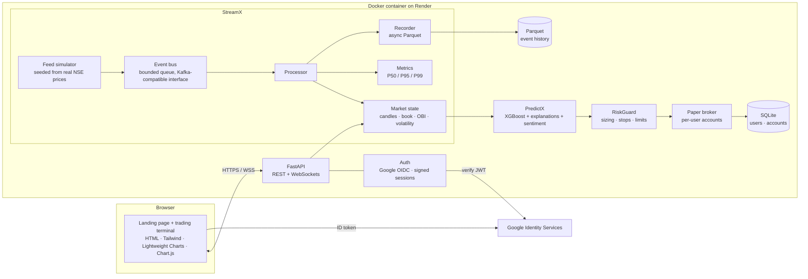

The **hot path** (bus → processor → market state → metrics) runs entirely in memory. The **cold path** (Parquet recording, account persistence) is asynchronous or happens on user actions only. This follows the separation recommended in [6].

## 5.2 StreamX: Market-Data Engine

**Figure 5.3: StreamX event pipeline and timestamp points**

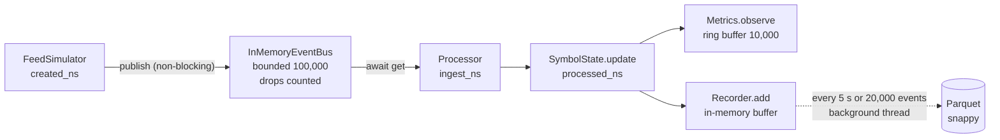

- **Bus.** An abstract `EventBus` with `publish`, `get` and `depth`. The prototype uses `InMemoryEventBus`, an `asyncio.Queue` bounded at 100,000 events. When it is full, new events are dropped and counted (back-pressure that never blocks the producer). A `KafkaEventBus` class documents the production mapping: topic `market-events`, key = symbol.
- **Processor.** A single coroutine: take an event, stamp `ingest_ns`, update `SymbolState`, stamp `processed_ns`, record metrics, and hand the event to the recorder.
- **Market state.** Per symbol: last price, BBO, five-level book, OBI, event count, and a candle series (the last 400 real bars followed by live candles). Each live candle represents one simulated 5-minute bar and closes every `BAR_SECONDS` = 10 s of real time.
- **Metrics.** Two 10,000-sample ring buffers (state-update and end-to-end latency). Percentiles and a latency histogram are computed once per second, and events/s is counted per second with a 120-second history.
- **Recorder.** Buffers rows in memory and writes a Snappy-compressed Parquet part file every 5 s or 20,000 events, in a worker thread (`asyncio.to_thread`), so disk I/O never runs on the event loop.

## 5.3 PredictX: AI Intelligence Engine

PredictX computes ten scale-free features from the candle series (Table 6.2) and applies the trained XGBoost model to the latest bar to obtain class probabilities. It then:

1. takes the **model view** as the arg-max class and the **raw confidence** as its probability;
2. computes **per-feature contributions** for the predicted class and writes the top four as sentences, for example *"RSI is 84 (overbought), which supports SELL"*;
3. applies a documented **heuristic blend**:
   - +0.04 if order-book pressure agrees with a BUY or SELL view, −0.05 if it disagrees;
   - +0.02 if sample sentiment agrees;
4. outputs **NO TRADE** if the adjusted confidence is below the threshold (the median validation confidence, 0.351) or annualised volatility exceeds 80%.

Every response includes the horizon (6 bars ≈ 30 simulated minutes), the model version and the disclaimer *"Educational prototype. Confidence is not a probability of profit. Not financial advice."*

## 5.4 RiskGuard: Risk Management Engine

RiskGuard is a pure function `evaluate(symbol, side, qty, bid, ask, atr, ann_vol, signal, portfolio, limits) → verdict`. It has no I/O and no randomness, so it is deterministic and unit-testable. Table 6.3 lists its rules. Its output is a status (APPROVED, REDUCED or REJECTED) together with:
- approved quantity, entry, stop-loss, target, R:R and money at risk;
- exposure after the trade and a risk level (LOW, MODERATE or HIGH);
- a list of human-readable **reasons**.

The design follows the principle from the survey that *a prediction must never trigger a trade automatically*.

## 5.5 Paper Broker

Each user has a `PaperAccount`:
- cash, positions (quantity and average price), realised P&L in total and by day, an order log of up to 500 entries, and an equity curve of up to 2,000 points;
- market orders fill at the live ask (BUY) or bid (SELL);
- every order, including rejected ones, is stored with the AI signal and the RiskGuard verdict;
- account state is serialised to SQLite after each order, and an equity snapshot is taken every 5 s.

**Figure 5.2: Sequence of a paper order**

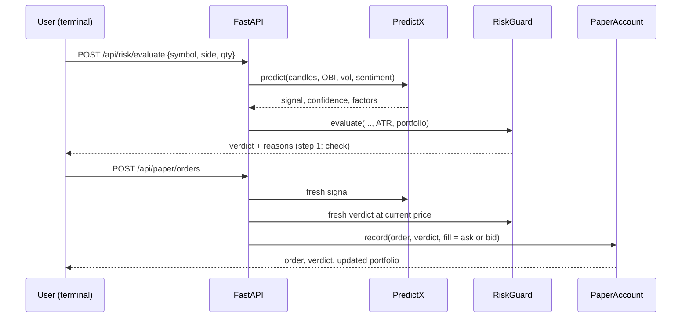

The order is **re-evaluated when it is submitted**, so an earlier approval cannot be used to bypass the limits.

## 5.6 Storage Design

| Data | Prototype store | Rationale | Production equivalent |
|---|---|---|---|
| Live market state | Process memory (`SymbolState`) | Nanosecond-to-microsecond access on the hot path | Redis / ElastiCache |
| Event history | Parquet files (Snappy) | Columnar, compact, data-lake-ready | Amazon S3 + Athena |
| Users and accounts | SQLite | Zero-administration relational store | Amazon RDS PostgreSQL |
| Historical bars | CSV cache | Simple, versionable | Time-series DB (TimescaleDB) |
| Model | XGBoost JSON + metrics JSON | Portable, versioned with the code | Model registry / S3 |

Kafka was evaluated and deliberately **not** deployed. For a single process at thousands of events per second, it would add brokers, network hops and operations work without a measurable benefit. The bus interface keeps it as a drop-in upgrade.

## 5.7 Event Schema

**Table 5.1: Normalised market-event schema (`MarketEvent`)**

| Field | Type | Description |
|---|---|---|
| `seq` | int | Monotonic sequence number assigned by the feed (unique; used for integrity checks) |
| `symbol` | str | Instrument identifier (RELIANCE, TCS, INFY, HDFCBANK) |
| `type` | str | Event type; `TRADE` = trade print plus book snapshot |
| `price` | float | Traded price (at the bid or ask) |
| `qty` | int | Traded quantity (1–250) |
| `bids` | list[(price, qty)] × 5 | Bid levels, best first |
| `asks` | list[(price, qty)] × 5 | Ask levels, best first |
| `created_ns` | int | Feed creation time (`perf_counter_ns`) |
| `ingest_ns` | int | Processor pickup time |
| `processed_ns` | int | State-update completion time |

The recorded Parquet row flattens this to `seq, symbol, price, qty, bid, ask, bid_qty, ask_qty, created_ns, ingest_ns, processed_ns`.

## 5.8 Database Design

**Table 5.2: Database entities**

| Entity | Fields | Notes |
|---|---|---|
| `users` | `id` (PK: `google:<sub>` or `guest:<hex>`), `email`, `name`, `picture`, `provider`, `created_at`, `last_login` | Upserted on each login |
| `accounts` | `user_id` (PK, FK → users), `state_json`, `updated_at` | Whole account state as JSON: cash, positions, realised P&L by day, orders, equity curve |

Storing the account as one JSON document keeps the order, position and P&L update *atomic* (one row write) and the schema simple. A normalised design (orders, fills and positions tables) is listed as future work for analytics at scale.

## 5.9 API Design

**Table 5.3: REST and WebSocket API** (session = signed cookie; ✔ = authentication required)

| Method | Path | Auth | Purpose |
|---|---|---|---|
| GET | `/api/health` | | Status, feed mode, data sources, model loaded |
| GET | `/api/symbols` | | Watchlist summary |
| GET | `/api/market/{symbol}/snapshot` | | Book, BBO, OBI, volatility |
| GET | `/api/market/{symbol}/candles?limit=` | | Historical + live candles |
| GET | `/api/predict/{symbol}` | | AI signal with explanation |
| GET | `/api/predict/model-info` | | Model card (metrics) |
| GET | `/api/sentiment/{symbol}` | | Sentiment score and sample headlines |
| GET | `/api/auth/config` | | Google client ID, guest flag |
| POST | `/api/auth/google` | | Verify Google ID token, start session |
| POST | `/api/auth/guest` | | Start guest session |
| GET | `/api/auth/me` | ✔ | Current user |
| POST | `/api/auth/logout` | | Clear session |
| POST | `/api/risk/evaluate` | ✔ | RiskGuard verdict + signal |
| GET | `/api/risk/portfolio` | ✔ | Exposure, limits, daily-loss usage |
| POST | `/api/paper/orders` | ✔ | Place paper order (re-checked) |
| GET | `/api/paper/portfolio` | ✔ | Cash, equity, positions, P&L |
| GET | `/api/paper/orders` | ✔ | Last 100 orders |
| GET | `/api/paper/equity` | ✔ | Equity curve |
| POST | `/api/paper/reset` | ✔ | Reset to ₹10,00,000 |
| GET | `/api/monitor/metrics` | | Throughput, latency, histogram, recorder |
| POST | `/api/monitor/rate` | | Set feed rate (1–20,000 events/s) |
| WS | `/ws/market` | | Market snapshots every 250 ms |
| WS | `/ws/monitor` | | Metrics every 1 s |

Requests are validated with Pydantic. The API returns 422 for an invalid body, 404 for an unknown symbol and 401 when no session exists. An interactive OpenAPI page is available at `/docs`.

## 5.10 Security and Reliability

- **Identity.** Google ID tokens are verified on the server (signature against Google's public keys, audience equal to the project's client ID, expiry, verified email) before a session is created.
- **Sessions.** The session is an HMAC-signed, HTTP-only cookie (`itsdangerous`) with SameSite=Lax, valid for 14 days, and marked `Secure` when `HTTPS_ONLY=true`. The signing key comes from the `SECRET_KEY` environment variable.
- **Authorisation.** Account, risk and order endpoints need a session, and each user can reach only their own account.
- **Secrets.** `.env`, the database and the secret-key file are excluded from Git, and production secrets live in Render's environment settings.
- **Transport.** HTTPS and WSS are terminated by Render's TLS edge.
- **Container.** The container runs as a non-root user.
- **Reliability.**
  - The bounded bus drops events instead of exhausting memory, and counts the drops.
  - The feed's catch-up after a stall is capped at 0.25 s.
  - A health-check endpoint is used by the platform.
  - Account state is written after every order.
  - Cache headers make browsers revalidate application files after each deploy.

## 5.11 Prototype-to-Production Cloud Mapping

**Table 5.4: Prototype-to-production cloud mapping**

| Prototype component | Production equivalent | Why the mapping is clean |
|---|---|---|
| `InMemoryEventBus` | Apache Kafka / Amazon MSK | Same publish/get interface; partition by symbol |
| Parquet files | Amazon S3 data lake | Same columnar format |
| SQLite | Amazon RDS PostgreSQL | Two-table schema; change the connection |
| `SymbolState` in memory | Redis / ElastiCache | Key–value snapshot per symbol |
| Single Docker container on Render | ECS / App Runner / EKS with autoscaling | Stateless API, environment configuration |
| Google Identity Services + signed cookie | Same, behind a load balancer | No server-side session store needed |

<div style="page-break-after: always;"></div>

# CHAPTER 6: METHODOLOGY AND ALGORITHMS

## 6.1 Overall Methodology

1. Select the market, instruments and a data source with permitted use (NSE large caps, Yahoo Finance historical bars).
2. Define the event schema and the timestamp convention (Table 5.1, Section 4.11).
3. Build ingestion and processing, then verify completeness with sequence numbers.
4. Engineer look-ahead-free features and verify that property with a unit test.
5. Create purged chronological train/validation/test partitions.
6. Train baselines and XGBoost, select the model on validation data only, and evaluate once on the test set.
7. Apply RiskGuard to the signals and simulate trading with transaction costs.
8. Benchmark capture, persistence, load, decision latency and the deployed API.
9. Report every result against baselines, together with the limitations.

## 6.2 Dataset

**Table 6.1: Dataset description**

| Property | Value |
|---|---|
| Source | Yahoo Finance via `yfinance` (public historical data), cached as CSV in `backend/data/raw/` |
| Instruments | RELIANCE.NS, TCS.NS, INFY.NS, HDFCBANK.NS |
| Frequency | 5-minute OHLCV bars, NSE session 09:15–15:30 IST (75 bars per day) |
| Period | Late August to 23 November 2026 (about 60 trading days, the provider's 5-minute history window) |
| Size | About 4,300 bars per symbol, about 17,200 bars in total |
| Splits (rows after feature warm-up) | Train 11,659 · Validation 2,039 · Test 3,438 |
| Test period | 5–23 November 2026 |
| Licence / use | Public data used for non-commercial educational research |
| Synthetic data | Only the live stream (Section 6.3); never used for training or evaluation |

## 6.3 Live Feed Simulator

Each symbol starts from its last real close and its measured daily volatility $\sigma_d$. The per-bar volatility is $\sigma_{bar} = \sigma_d / \sqrt{75}$. On each event, with $\Delta b$ = elapsed real time / `BAR_SECONDS`:

$$ P \leftarrow P \exp\!\left(0.35\,g\,\sigma_{bar}\Delta b + \sigma_{bar}\sqrt{\Delta b}\,Z\right),\quad Z \sim \mathcal{N}(0,1) \qquad (6.1) $$

where $g \in [-1, 1]$ is a hidden **regime**. With probability $\Delta b/5$ the regime picks a new random target, and it drifts smoothly towards it. The regime also skews book quantities (bids × (1 + 0.7g), asks × (1 − 0.7g)) and the probability that a trade prints at the ask (0.5 + 0.3g). This makes OBI informative, as it is in real markets. Prices are rounded to the ₹0.05 tick, spreads are 1–3 ticks, and the book has five levels.

**Pacing.** Every 10 ms the generator wakes and creates $\lfloor \text{rate} \times \Delta t + \text{carry} \rfloor$ events. This keeps the achieved rate correct despite the coarse sleep resolution of the Windows event loop. The feed is labelled **SIMULATED** wherever it is shown.

## 6.4 Preprocessing

- Bars are sorted by timestamp and de-duplicated by the data loader. Missing volume is treated as 0.
- Infinite values from divisions by zero are converted to NaN.
- Rows with NaN in any feature or label are dropped. These are the warm-up rows at the start and the last *H* rows, whose forward label is unknown.
- Splits are made **per symbol** in time order before the symbols are combined, so no symbol's future can leak into another's training period.

## 6.5 Feature Engineering

**Table 6.2: Feature definitions** (all use only bars ≤ t)

| Feature | Definition | Window |
|---|---|---|
| `ret_1`, `ret_5`, `ret_15` | $r^{(k)}_t$, simple return over k bars | 1, 5, 15 |
| `rsi_14` | Relative Strength Index (Wilder) | 14 |
| `macd_hist` | MACD histogram / price | 12, 26, 9 |
| `ema_ratio` | EMA9 / EMA21 − 1 | 9, 21 |
| `bb_pctb` | Bollinger %B | 20, ±2σ |
| `atr_pct` | ATR / price | 14 |
| `vol_20` | Std. dev. of 1-bar returns | 20 |
| `volume_z` | Volume z-score, clipped ±3 | 20 |

Every feature is a return, a ratio or a z-score, which makes it scale-free. A model trained on one stock can therefore be applied to the others and to the simulated live feed. The unit test `test_features_have_no_lookahead` changes all rows after index *t* and asserts that the features at rows ≤ *t* are unchanged.

## 6.6 Target Definition

With horizon H = 6 bars (30 minutes) and threshold θ = 0.25%:

$$ y_t = \begin{cases} \text{BUY} & \text{if } C_{t+H}/C_t - 1 > \theta \\ \text{SELL} & \text{if } C_{t+H}/C_t - 1 < -\theta \\ \text{HOLD} & \text{otherwise} \end{cases} \qquad (6.2) $$

Labels use bar (clock) time on close prices. θ is about the typical 30-minute move and is larger than a realistic intraday round-trip cost (about 5–10 bps), so a correct BUY label represents a move worth trading. Class balance: train is SELL 20.0% / HOLD 63.5% / BUY 16.5%, and test is SELL 20.5% / HOLD 59.3% / BUY 20.2%.

**Purging.** The *H* rows before each split boundary are removed, because their labels look into the next partition [10].

## 6.7 Model Development

- **Baselines:**
  - always predict the majority class (HOLD);
  - stratified random guessing (mean of 50 seeds);
  - a momentum rule (BUY if `ret_5` > θ, SELL if < −θ);
  - an RSI rule (BUY if RSI < 30, SELL if > 70);
  - balanced multinomial logistic regression on standardised features;
  - a balanced random forest (300 trees, depth 6).
- **XGBoost (PredictX):**
  - parameters: `n_estimators` up to 400, `max_depth` 4, `learning_rate` 0.05, `subsample` 0.8, `colsample_bytree` 0.8, `min_child_weight` 5;
  - objective `multi:softprob`, balanced sample weights, early stopping after 40 rounds without improvement in validation log loss, `random_state` 42;
  - training stopped at the 10th tree (`best_iteration` = 9), which suggests that most of the learnable signal is shallow.
- **Selection.** Hyperparameters were fixed from validation behaviour only. The test set was used once, for the reported numbers.
- **NO TRADE threshold.** The median of the maximum class probability on the validation set, clipped to [0.34, 0.65], which gives 0.351.

## 6.8 Evaluation Protocol

- **Classification:**
  - accuracy, macro precision, macro recall and macro-F1, plus F1 for each class;
  - directional hit-rate against its chance level;
  - log loss and Brier score;
  - confusion matrix;
  - a calibration table and ECE;
  - results for each symbol.
- **Trading:**
  - a chronological simulation on the test period at round-trip costs of 0, 5, 10 and 20 bps;
  - compared with buy-and-hold and with random entries at the same entry rate (100 seeds);
  - total return, annualised Sharpe ratio, maximum drawdown, number of trades, win rate and average trade return.
- **Systems:** latency percentiles, achieved throughput, CPU, memory, queue depth, drops, persistence lag and integrity (row count and unique `seq` against events processed).

## 6.9 Stream Processing Algorithm

```text
Algorithm 1: StreamX processor loop
loop forever:
    ev ← await bus.get()                     # blocks only when the queue is empty
    ev.ingest_ns ← perf_counter_ns()
    s ← states[ev.symbol]
    s.last ← ev.price; s.bids, s.asks ← ev.bids, ev.asks
    s.bid, s.ask ← ev.bids[0].price, ev.asks[0].price
    s.OBI ← (Σ bid qty − Σ ask qty) / (Σ bid qty + Σ ask qty)
    update or roll the live candle (one candle per BAR_SECONDS of real time)
    ev.processed_ns ← perf_counter_ns()
    metrics.observe(ev)                      # append to latency ring buffers
    recorder.add(ev)                         # append a row to the in-memory buffer (no I/O)

Algorithm 2: Recorder (separate coroutine)
loop every 0.5 s:
    if buffer ≥ 20,000 rows or 5 s since the last flush:
        rows ← swap(buffer, [])
        await to_thread(write_parquet, rows) # file I/O off the event loop
```

## 6.10 Risk Evaluation Algorithm

**Table 6.3: RiskGuard rules and parameters**

| # | Rule | Parameter | Effect |
|---|---|---|---|
| 1 | AI gate | NO TRADE or opposite signal → reject; HOLD → size × 0.5 | REJECTED / smaller size |
| 2 | Daily loss limit | Realised loss today ≥ 3% of starting capital | REJECTED |
| 3 | Stop-loss | $d = \max(1.5\,\text{ATR},\ 0.2\% \cdot \text{entry})$ | Defines risk per share |
| 4 | Target and R:R | $m = \text{clip}(1.5 + 30(c - \tfrac13),\ 1,\ 4.5)$; R:R = m / 1.5; target = entry + d · R:R | REJECTED if R:R < 1.2 |
| 5 | Position size | $q_{risk} = \lfloor 0.01 E / d \rfloor$ | Upper bound on quantity |
| 6 | Exposure caps | Single stock ≤ 20% of equity; total ≤ 60%; never more than cash | REDUCED to fit |
| 7 | Sell side | Long-only; SELL allowed up to the held quantity | REDUCED / REJECTED |

```text
Algorithm 3: RiskGuard.evaluate (BUY)
if signal ∈ {NO_TRADE, SELL}: return REJECTED(reason)
if realised_loss_today ≥ 3% · starting_cash: return REJECTED(reason)
d ← max(1.5·ATR, 0.002·entry); rr ← reward_multiple(conf) / 1.5
if rr < 1.2: return REJECTED(reason)
q_risk ← floor(0.01·equity / d);  if signal = HOLD: q_risk ← q_risk // 2
allowed ← min(q_risk, single-stock room, total room, cash room)
if allowed ≤ 0: return REJECTED(binding limit)
approved ← min(requested or allowed, allowed)
return (APPROVED if approved = requested else REDUCED), stop, target, rr, reasons
```

The reward multiple grows with the model's edge over the uninformed level of 1/3. Because model confidences are compressed (mostly 0.34–0.42), a confidence of 0.40 gives a multiple of 3.5 and an R:R of 2.33. A confidence of 0.343 gives an R:R of 1.2, which is the minimum.

## 6.11 Trading Simulation Design (Experiment E)

- **Capital and timing.** One shared ₹10,00,000 account. The strategies are long-only and are simulated over the 3,438 test bars. A signal is formed at the close of bar *t* and executed at the **open of bar t + 1**, which avoids using information before it is available.
- **Costs.** Cost per side = half of the round-trip cost in bps, applied to the notional value on entry and on exit. Indian discount-broker intraday costs (brokerage, STT, exchange and SEBI charges, GST and stamp duty) are roughly 5–8 bps per round trip for orders of this size before slippage. 10 bps is used as the realistic base case.
- **Strategies:**

  | Strategy | Entry | Size | Exit |
  |---|---|---|---|
  | Buy-and-hold | 25% of capital per symbol at the first test bar | fixed | held to the end |
  | XGBoost raw | model view = BUY | 20% of equity | after H = 6 bars |
  | XGBoost + RiskGuard | BUY with confidence ≥ threshold and annualised volatility ≤ 80%, approved by the production `evaluate()` function | RiskGuard quantity | stop-loss, target, or after H bars (stop checked first within a bar) |
  | Momentum rule | `ret_5` > θ | 20% of equity | after H bars |
  | RSI rule | RSI < 30 | 20% of equity | after H bars |
  | Random entries | same entry probability as XGBoost raw | 20% of equity | after H bars (100 seeds) |


<div style="page-break-after: always;"></div>

# CHAPTER 7: IMPLEMENTATION

## 7.1 Development Environment

| Item | Value |
|---|---|
| Development machine | Windows 10 Home (build 19045), Intel Core i3-6006U @ 2.0 GHz (2 cores / 4 threads), 11.9 GB RAM |
| Language / runtime | Python 3.11.1 (local); Python 3.11-slim Docker image (cloud) |
| Key libraries | FastAPI 0.165, Uvicorn, Pydantic 2, NumPy 2.4, pandas 3.1, PyArrow 26, XGBoost 3.2, scikit-learn 1.9, yfinance, google-auth, itsdangerous, httpx, pytest |
| Frontend | HTML5, vanilla JavaScript, Tailwind CSS 3.4.5 (precompiled with the CLI), TradingView Lightweight Charts 4.1.3, Chart.js 4.4.1 (both served from the application, not a CDN) |
| Source control | Git, GitHub (`rohan911438/TradeMind-AI`), tagged release v1.0.0 |
| Cloud | Render web service (Docker runtime, Singapore region, free plan) with auto-deploy on push to `main` |
| Tooling | Claude Code (AI coding assistant) was used for scaffolding, refactoring, test generation and documentation under the team's direction. All design decisions, results and claims were reviewed by the team. *[Keep or adapt this disclosure according to the department's policy on AI tools.]* |

## 7.2 Repository Structure

```text
TradeMind-AI/
├── Dockerfile · .dockerignore · run.bat · README.md · PPT.md · CLAUDE.md
├── backend/
│   ├── requirements.txt · .env.example
│   ├── app/
│   │   ├── main.py            # FastAPI app: REST, WebSockets, sessions, cache middleware, static files
│   │   ├── config.py          # Settings from environment / backend/.env (12-factor)
│   │   ├── auth.py            # Google ID-token verification, guest users, current_user dependency
│   │   ├── db.py              # SQLite: users, accounts
│   │   ├── streamx/           # events · bus · simulator · state · metrics · recorder · engine
│   │   ├── predictx/          # data · features · train · model · sentiment
│   │   ├── riskguard/engine.py
│   │   └── paper/broker.py
│   ├── models/                # xgb_model.json, metrics.json (model card)
│   ├── data/raw/              # cached NSE 5-minute bars (CSV), sources.json
│   ├── static/                # index.html (landing), app.html (terminal), css/, js/, vendor/, img/
│   ├── scripts/e2e_check.py   # 67 end-to-end checks
│   └── tests/                 # 17 unit tests
├── tools/tailwind/            # Tailwind build configuration
├── docs/                      # synopsis, SRS, architecture, demo guide, test report, deployment guide
└── thesis/
    ├── main.md                # this report
    ├── benchmarks/            # bench_stream.py, bench_model.py, bench_api.py, make_figures.py, results/*.json
    └── figures/               # generated charts
```

| Component | Files | Lines |
|---|---|---|
| Backend application (Python) | 23 | ~1,370 |
| Frontend (HTML + JS + theme CSS) | 5 | ~1,260 |
| Unit tests + end-to-end checks | 5 | ~260 |
| Benchmark suite | 4 | ~1,020 |

The small size is deliberate. Each module fits in a single reading, which matters for a viva and for maintenance.

## 7.3 Backend and API

`app/main.py` creates one `StreamEngine`, one `Predictor` and one `AccountManager` at import time. A FastAPI *lifespan* handler starts the engine's tasks (simulator, processor, metrics, recorder) and an equity-snapshot task every 5 s; on shutdown it saves all accounts and flushes the recorder.

- **Routing.** REST endpoints and two WebSocket endpoints, as listed in Table 5.3. Bodies are validated by Pydantic models (`OrderIn`, `RateIn`, `GoogleIn`).
- **Authentication.** Protected endpoints declare `Depends(auth.current_user)`, which reads the session's `uid` and returns 401 if it is missing.
- **Middleware.** A `SessionMiddleware` handles signed cookies. A small HTTP middleware sets `Cache-Control: no-cache` on application files and `public, max-age=86400` on vendor bundles, so that new deployments reach users immediately.
- **Static files.** The frontend is served by the same process (`StaticFiles` mounted at `/`, plus `/app` for the terminal), so there is no separate frontend build or deployment.

## 7.4 StreamX Implementation

- **`events.py`.** `MarketEvent` is a `@dataclass(slots=True)` with three nanosecond timestamps. Slots reduce memory use and attribute-access time on the hot path.
- **`bus.py`.** The `EventBus` ABC, `InMemoryEventBus` (bounded `asyncio.Queue`, `put_nowait` with drop counting) and a documented `KafkaEventBus` stub.
- **`simulator.py`.** `FeedSimulator` implements Equation 6.1 with `random.Random(seed)` for reproducibility, rounds prices to the tick, generates the skewed five-level book, and paces by real elapsed time with fractional carry-over. `set_rate()` clamps the rate to 1–20,000 events/s.
- **`state.py`.** `SymbolState.update()` performs the O(1) state update and candle roll. `ann_vol()` computes annualised volatility from the last 60 candles, excluding returns larger than 5%, which removes overnight gaps.
- **`metrics.py`.** `deque(maxlen=10_000)` ring buffers. A once-per-second coroutine computes events/s, percentiles (`numpy.percentile`) and a 9-bucket latency histogram, and caches the result for the API.
- **`recorder.py`.** A row buffer, flushed by `asyncio.to_thread(pq.write_table, …)` to `data/events/session-YYYYMMDD-HHMMSS/part-NNNNN.parquet` with Snappy compression. It reports recorded rows, files, buffered rows, seconds since the last flush and the last write time.
- **`engine.py`.** Wires the pieces together. In a worker thread it loads the history for each symbol, seeds the simulator with the last real close and the measured daily volatility, and exposes `monitor()` for the API.

## 7.5 PredictX Implementation

- **`data.py`.** `load_history(symbol, refresh)` returns cached CSV bars if present; otherwise it downloads 60 days of 5-minute data from Yahoo Finance. If the download fails it generates a synthetic series, so the application can still start, and records the source as `synthetic` in `sources.json`, which the UI displays. All reported results use **real** data (`sources.json` = yfinance).
- **`features.py`.** Vectorised pandas implementations of the ten features (Table 6.2) and the labels (Equation 6.2).
- **`train.py`.** Builds the purged, per-symbol chronological split, trains XGBoost with balanced weights and early stopping, computes the model card, and saves `xgb_model.json` and `metrics.json`. The model card holds accuracy, macro-F1, the baselines, directional hit-rate and its chance level, confident-signal precision and coverage, the threshold, the confusion matrix, the classification report and feature importance. A full training run takes about 1–2 seconds on the laptop.
- **`model.py`.** `Predictor.predict()` builds features from the live candle frame, computes probabilities and per-feature contributions (`pred_contribs=True`), turns the top four into sentences, applies the pressure and sentiment blend and the NO TRADE gate, and returns the response with the disclaimer.
- **`sentiment.py`.** A finance lexicon (about 25 positive and 20 negative terms) scores four sample headlines per symbol, each prefixed "Sample:".

## 7.6 RiskGuard and Paper Trading

- **`riskguard/engine.py`.** A `Limits` dataclass whose defaults come from configuration, and `reward_multiple`, `risk_level` and `evaluate` exactly as in Algorithm 3. The verdict includes the binding limit when a quantity is reduced; for example: *"Quantity reduced from 500 to 143: limited by single-stock cap (20%)"*.
- **`paper/broker.py`.** `PaperAccount.record()` fills an approved order at the given price, updates the average price, cash and realised P&L (in total and by IST day), stores the order with its signal and verdict, and writes the account to SQLite. `portfolio(marks)` values the positions at the mid-price and returns equity, exposure, weights and P&L.

## 7.7 Authentication

1. The browser loads Google Identity Services and renders the "Sign in with Google" button, using the client ID from `/api/auth/config`.
2. After consent, Google returns an ID token (a signed JWT), which the frontend posts to `/api/auth/google`.
3. `auth.verify_google_token` calls `google.oauth2.id_token.verify_oauth2_token`, which checks the RSA signature against Google's published keys, the audience, the issuer and the expiry. It then requires `email_verified` and upserts the user `google:<sub>`.
4. The server stores `uid` in the signed session cookie.

**Guest mode** (`/api/auth/guest`) creates a `guest:<random>` user so that a demonstration never depends on OAuth configuration.

## 7.8 Frontend Implementation

**Landing page (`index.html`, `landing.js`).**
- A hero section with a *live* card showing price, AI signal and P99 latency, fetched from the API.
- A live ticker, a section on each engine, a "how it works" flow, the cloud stack, and calls to action.

**Trading terminal (`app.html`, `app.js`).** An authentication gate followed by six screens:

| Screen | Content |
|---|---|
| Market | Watchlist; candlestick and volume chart (Lightweight Charts) updated from `/ws/market`; five-level order book; imbalance gauge; mini signal card; quick buy and sell buttons |
| AI Signals | Signal card, class probabilities, explanation, bars of factor contributions, sentiment headlines, model card with baselines and confusion matrix |
| Paper Trade | Two-step ticket (① *Check with RiskGuard* → ② *Place paper order*), "use suggested size", verdict panel with reasons, positions with one-click close, order history |
| Portfolio & Risk | Account tiles, equity curve (Chart.js), exposure against limits, risk per stock, rules table, account reset |
| StreamX Monitor | Throughput chart, P50/P95/P99 tiles, latency histogram, feed-rate slider (10–5,000 events/s), pipeline diagram, recorder status |
| Architecture | Engine diagram, cloud mapping, honest-scope notes |

**Performance.** Tailwind CSS is **precompiled** to a 15 KB file. The Tailwind runtime script re-scanned the whole page on every live update and froze the browser (defect #4 in Table 8.13).

**Event handling.** Table clicks use event delegation, so buttons stay clickable while rows re-render every 3 s.

**Responsive layout.** Grids collapse to one column below the `xl` breakpoint, and `min-width: 0` on grid children prevents overflow. Every screen was checked for horizontal overflow at a width of 390 px.

[Insert Figure 7.1–7.6: screenshots of each screen from the live application at https://trademind-ai-ujm6.onrender.com. See Appendix 5 for the capture list.]

## 7.9 Cloud Deployment

```dockerfile
FROM python:3.11-slim
RUN apt-get update && apt-get install -y --no-install-recommends libgomp1   # OpenMP for XGBoost
COPY backend/requirements.txt . ; RUN pip install --no-cache-dir -r requirements.txt
COPY backend/ /app/ ; RUN useradd -m app && chown -R app /app ; USER app
CMD uvicorn app.main:app --host 0.0.0.0 --port ${PORT} --proxy-headers --forwarded-allow-ips='*'
```

| Setting | Value |
|---|---|
| Service | Render web service `trademind-ai`, Docker runtime, region Singapore, free plan |
| URL | https://trademind-ai-ujm6.onrender.com (TLS by Render) |
| Deploy trigger | Push to `main` on GitHub (verified `trigger = new_commit`) |
| Health check | `GET /api/health` |
| Environment | `GOOGLE_CLIENT_ID`, `SECRET_KEY` (random 64 hex characters), `HTTPS_ONLY=true` |
| Google OAuth origins | the Render URL and `http://localhost:8000` |
| Free-plan behaviour | sleeps after ~15 minutes idle (first request ~1 minute); 512 MB RAM; ephemeral disk (accounts and recordings reset on restart) |
| Operating cost | ₹0 per month (free plan). An always-on production instance would be the platform's smallest paid plan, plus licensed data |

## 7.10 Error Handling and Logging

- **Back-pressure.** When the bus is full, events are dropped and counted (`dropped`, visible in the monitor), so memory never grows without bound.
- **Stall protection.** The simulator caps catch-up at 0.25 s after a stall, so a paused process does not release a flood of events.
- **Validation.** Pydantic returns 422 with field details; unknown symbols return 404; unauthenticated requests return 401; invalid Google tokens return 401 with the reason.
- **Data fallback.** If data cannot be downloaded, the application starts in synthetic mode and the UI shows this.
- **Shutdown.** The recorder is flushed and accounts are saved when the application shuts down.
- **Logs.** Uvicorn access and error logs, available in the Render dashboard. A health endpoint is used for platform checks.

## 7.11 Testing Approach and Defects Fixed

| Layer | Tool | Count |
|---|---|---|
| Unit | pytest | 17 tests: 12 RiskGuard, 3 feature/label (including look-ahead), 2 broker P&L |
| End-to-end | `scripts/e2e_check.py` (httpx + websockets) | 67 checks covering routing, market, PredictX, authentication and security, RiskGuard validation, full trade lifecycle with P&L reconciliation, account isolation, monitor and WebSockets |
| Manual / browser | Chrome, desktop and 390 px mobile | All six screens and the landing page |

The defects found during testing and their fixes are listed in Table 8.13 (Section 8.12).


<div style="page-break-after: always;"></div>

# CHAPTER 8: EXPERIMENTAL SETUP, TESTING AND RESULTS

## 8.1 Experimental Objectives

The experiments answer seven questions:

| Experiment | Question |
|---|---|
| A: Capture interval | How much market detail does fixed-interval sampling lose compared with event-driven capture? |
| B: Persistence | What does persistence cost the processing path, synchronously versus asynchronously? |
| C: Load | How do throughput, latency, CPU, memory and integrity behave as the event rate rises, and where does the system saturate? |
| D: Model | Does the model carry out-of-sample information beyond naive and simple ML baselines? |
| E: Trading | Do the signals, with and without RiskGuard, produce value after realistic transaction costs? |
| F: Decision path | How long does it take to compute a signal and a risk verdict, and where is the time spent? |
| G: Cloud | What latency do users see from the deployed system compared with a local run? |

## 8.2 Test Environment

**Table 8.1: Test environment**

| Item | Local (Experiments A–G) | Cloud (Experiment G, monitor readings) |
|---|---|---|
| Machine | Laptop, Intel Core i3-6006U @ 2.0 GHz, 2 physical cores / 4 threads, 11.9 GB RAM | Render free web service (shared vCPU, 512 MB RAM) |
| OS | Windows 10 Home 10.0.19045 | Linux container (python:3.11-slim) |
| Python / libraries | 3.11.1; NumPy 2.4.6, pandas 3.1.1, PyArrow 26.0.1, XGBoost 3.2.0, scikit-learn 1.9.1, FastAPI 0.165.0 | same `requirements.txt` |
| Event loop | asyncio `ProactorEventLoop` | asyncio (uvloop via `uvicorn[standard]`) |
| Clock | `time.perf_counter_ns()` (QueryPerformanceCounter, monotonic) | `time.perf_counter_ns()` (CLOCK_MONOTONIC) |
| Network | loopback | client in Kolkata → Render Singapore over the public internet (HTTPS) |
| Storage | local SSD/HDD (NTFS); temporary directories per run | ephemeral container disk |
| Other load | the development server was stopped; no other heavy processes | shared multi-tenant host |
| Date | 23 November 2026 | 23 November 2026 |

All raw results are in `thesis/benchmarks/results/*.json`, and the commands to reproduce them are in Appendix 7.

## 8.3 Workload Design

- **Event source.** The production `FeedSimulator` with a fixed seed. Each event is one trade print plus a five-level book for one of the four symbols, in round-robin order.
- **Rates.** 100, 500, 1,000, 2,000, 5,000, 10,000 and 20,000 events/s (Experiment C), 1,000 events/s (Experiment B, paced) and 200 / 2,000 events/s (Experiment A).
- **Procedure.** Each run has a 2-second warm-up followed by a 10-second measurement window. Experiment C repeats every rate 3 times and reports the mean, and the per-trial values are kept in the JSON. Experiment B's maximum-throughput ("drain") test pre-generates events and processes them as fast as possible, reporting the median of 3 repeats after a warm-up pass.
- **Integrity.** After each run, the recorded Parquet (or SQLite) rows are read back and compared with the number of events processed: row count, unique `seq` and duplicates. The run also checks that generated = processed + dropped + left in queue.

## 8.4 Performance Metrics

**Table 8.2: Performance metric definitions**

| Metric | Definition |
|---|---|
| Achieved throughput | Events processed during the measurement window ÷ window length |
| State-update latency | `processed_ns − ingest_ns` (hot-path work) |
| Processing-path latency | Time from `ingest_ns` until the persistence call returns |
| End-to-end latency | `processed_ns − created_ns` (includes queueing and the simulator's 10 ms batches) |
| Persistence lag | Time from `processed_ns` until the batch containing the event is written to disk |
| P50 / P95 / P99 / max | Percentiles over every event in the measurement window |
| Dropped | Events rejected by the bounded bus (`publish` returned false) |
| Integrity | Rows written = unique `seq` = events processed; duplicates = 0 |
| CPU | Process CPU time over the window as a percentage of one core (`psutil`) |
| RSS | Resident memory at the end of the run |

## 8.5 Experiment A: Capture Interval

**Method.** The simulator ran for 30 s at 200 events/s (50 events/s per symbol, the production default) and for 20 s at 2,000 events/s (500 per symbol). Every event was kept. Fixed-interval samplers with intervals of 10, 50, 100, 500 and 1,000 ms were then applied to the same stream for each symbol. For each interval the experiment counted:
- the events the sampler never observes (every event except the last one in each interval);
- the price changes hidden between consecutive snapshots;
- the mean price range (high − low) inside an interval;
- the ratio of realised variance in the sampled series to that of the full tick series.

**Table 8.3: Experiment A: capture-interval results**

| Capture method | Snapshots (50 ev/s/sym) | Events hidden | Price changes hidden | Range inside interval | Snapshots (500 ev/s/sym) | Events hidden | Price changes hidden | Range inside interval |
|---|---|---|---|---|---|---|---|---|
| Event-driven (every tick) | 5,995 | 0% | 0% | – | 40,023 | 0% | 0% | – |
| Snapshot every 10 ms | 11,988 | 2.9% | 2.6% | 0.02 bps | 8,004 | 86.9% | 85.2% | 1.17 bps |
| Snapshot every 50 ms | 2,400 | 60.0% | 58.2% | 1.22 bps | 1,604 | 96.0% | 95.2% | 2.41 bps |
| Snapshot every 100 ms | 1,200 | 80.0% | 78.6% | 2.40 bps | 804 | 98.0% | 97.5% | 3.50 bps |
| Snapshot every 500 ms | 240 | 96.0% | 95.7% | 6.73 bps | 164 | 99.6% | 99.5% | 7.71 bps |
| Snapshot every 1,000 ms | 120 | 98.0% | 97.8% | 9.81 bps | 84 | 99.8% | 99.8% | 10.38 bps |

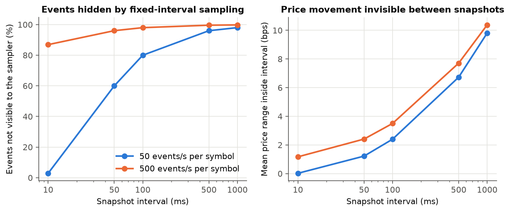

**Figure 8.1: Events hidden by fixed-interval sampling; price movement between snapshots**

**Observations.**
1. The measured hidden fraction follows Equation 4.2 closely. At 50 events/s per symbol and Δt = 100 ms, λΔt = 5, so the bound is 1 − 1/5 = 80%, and 79.98% was measured. At 500 events/s per symbol the bound is 98%, and 97.99% was measured.
2. A 10 ms sampler looks almost lossless at the default rate (2.9%) only because it samples faster than events arrive. It takes **twice as many snapshots as there are events**, which wastes storage while still missing some events. At 10× the event rate the same sampler hides 87% of events. No fixed interval is right for every rate, whereas event capture is.
3. At 100 ms, an average of 2.4–3.5 bps of price range per symbol happens unseen within each interval. That is comparable to the 1–3-tick spread of these stocks.
4. The realised-variance ratio falls below 1 as the interval grows (0.74 at 100 ms, 50 events/s per symbol). Part of this is the expected loss of information. Part of it is the removal of **bid–ask bounce**, because trades alternate between the bid and the ask. Event-level data therefore needs microstructure-aware estimators, and sampling hides this noise rather than modelling it.
5. **Caveat.** The simulator publishes in 10 ms batches, so events within a batch have nearly identical creation times. Intervals of 10 ms or less are therefore not meaningful for this feed.

## 8.6 Experiment B: Synchronous vs Asynchronous Persistence

**Method.** The same pipeline was run with four persistence strategies:
1. **None:** state update only (a lower bound).
2. **Async Parquet:** the production `Recorder`, which buffers rows in memory and writes them in a background thread every 5 s.
3. **Sync SQLite WAL:** an `INSERT` and commit per event, `journal_mode=WAL`, `synchronous=NORMAL`.
4. **Sync SQLite FULL:** an `INSERT` and commit per event, `journal_mode=DELETE`, `synchronous=FULL`, which flushes to disk on every commit.

Each strategy ran a paced test (target 1,000 events/s, 10 s) and a drain test (maximum throughput).

**Table 8.4: Experiment B: persistence strategy at a target of 1,000 events/s**

| Strategy | Achieved rate | Processing path P50 | P95 | P99 | End-to-end P50 / P99 | Persistence lag P50 / P99 | Rows written = processed |
|---|---|---|---|---|---|---|---|
| None | 1,002 /s | 14.8 µs | 25.6 µs | 76.8 µs | 0.90 / 12.5 ms | – | – |
| **Async Parquet (TradeMind)** | **1,000 /s** | **19.6 µs** | **34.5 µs** | **65.4 µs** | **0.70 / 4.6 ms** | 2.57 / 5.50 s | ✔ 11,992 = 11,992, 0 duplicates |
| Sync SQLite (WAL, NORMAL) | 1,001 /s | 82.7 µs | 153.9 µs | 246.4 µs | 1.32 / 7.7 ms | 0 (written before processing completes) | ✔ 11,992 = 11,992 |
| Sync SQLite (FULL) | **55.5 /s** | 12,141 µs | 15,964 µs | 21,070 µs | 2.7 / 5.0 **s** | 0 | ✔ 1,423 = 1,423 |

**Table 8.5: Experiment B: maximum processing throughput (drain test, median of 3 repeats)**

| Strategy | Events | Throughput | Repeats | Per-event P50 / P99 | Time until durable |
|---|---|---|---|---|---|
| None | 50,000 | 103,533 /s | 102,682 – 107,213 | 8.4 / 23.5 µs | – |
| Async Parquet | 50,000 | 62,151 /s | 40,248 – 89,878 | 14.0 / 37.8 µs | 1.15 s (one 332 ms batch write) |
| Sync SQLite (WAL) | 20,000 | 8,851 /s | 8,003 – 9,801 | 81.9 / 318 µs | 2.28 s |
| Sync SQLite (FULL) | 2,000 | 60 /s | 60 – 62 | 12.0 / 21.1 ms | 33.4 s |

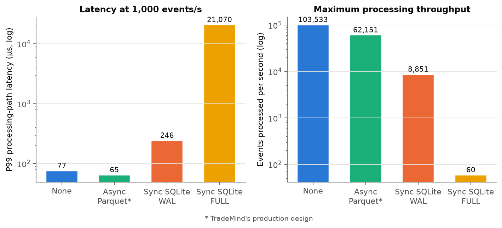

**Figure 8.2: Persistence strategies: P99 latency at 1,000 events/s (left) and maximum throughput (right), log scales**

**Observations.**
1. **Asynchronous persistence costs only microseconds on the processing path.** Appending a row to a buffer added about 5 µs at the median compared with no persistence. Its P99 (65 µs) was in fact lower than the no-persistence run's, which is within run-to-run noise at this rate.
2. **Synchronous persistence moves storage latency onto the hot path.** With WAL and `synchronous=NORMAL`, commits are not flushed to disk each time, yet the median processing path was still 4.2× slower and the P99 3.8× slower. Maximum throughput fell 12× compared with no persistence.
3. **Fully durable synchronous commits break the system.** With `synchronous=FULL`, each event waits for the disk (about 12 ms). Throughput fell to about 60 events/s, end-to-end latency reached seconds, and because the event loop was blocked, the feed could not even produce its target rate. A real feed would have overflowed or dropped data.
4. **The trade-off is durability.** The asynchronous design leaves an event up to about 5.5 s (P99) before it is on disk, so a process crash can lose up to one flush interval of recorded history. Market *state* is unaffected. For this application, where the recording is an analytics archive and not a ledger, the trade-off is appropriate. Account changes, which *are* a ledger, are written synchronously, but only once per user order.
5. The async drain throughput varied widely between repeats (40k–90k events/s). This is because the buffer grows to 50,000 Python tuples, which triggers garbage collection and memory reallocation. The production recorder flushes every 20,000 rows, which bounds this effect.
6. **Integrity:** in every mode, rows read back equalled events processed, with unique sequence numbers and no duplicates.

## 8.7 Experiment C: Load and Scalability

**Method.** The full production pipeline (simulator → bus → processor → metrics and async Parquet recorder) was run at seven target rates, three 10-second trials each.

**Table 8.6: Experiment C: load and scalability (mean of 3 trials)**

| Target (events/s) | Achieved (events/s) | State update P50 | P95 | P99 | End-to-end P50 | End-to-end P99 | CPU (% of one core) | RSS | Dropped | Integrity |
|---|---|---|---|---|---|---|---|---|---|---|
| 100 | 100.0 | 25.7 µs | 76.1 µs | 160.4 µs | 0.26 ms | 3.9 ms | 3.1% | 107 MB | 0 | ✔ |
| 500 | 500.3 | 15.5 µs | 36.0 µs | 75.2 µs | 0.54 ms | 3.4 ms | 10.6% | 108 MB | 0 | ✔ |
| 1,000 | 999.5 | 14.7 µs | 25.6 µs | 50.1 µs | 0.87 ms | 5.7 ms | 13.7% | 109 MB | 0 | ✔ |
| 2,000 | 2,002.4 | 12.5 µs | 21.8 µs | 36.0 µs | 1.62 ms | 10.9 ms | 29.6% | 111 MB | 0 | ✔ |
| 5,000 | **4,997.5** | **9.3 µs** | 19.4 µs | **28.7 µs** | 2.79 ms | 22.6 ms | 57.0% | 128 MB | 0 | ✔ |
| 10,000 | 8,558.4 | 8.7 µs | 17.6 µs | 26.3 µs | 95.4 ms | 328.9 ms | 98.2% | 138 MB | 0 | ✔ |
| 20,000 | 8,844.5 | 6.5 µs | 17.5 µs | 26.3 µs | 253.4 ms | 626.2 ms | 96.7% | 154 MB | 0 | ✔ |

Integrity (✔): in all 21 runs, Parquet rows = unique `seq` = events processed, with 0 duplicates. Generated = processed + dropped + queued, with 0 events unaccounted for.

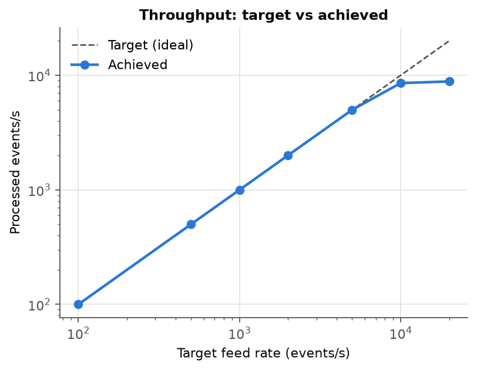

**Figure 8.3: Throughput: target vs achieved feed rate (log–log)**

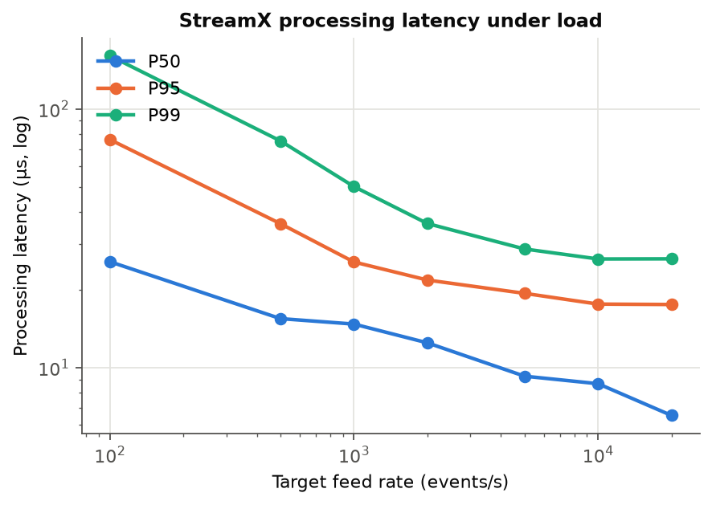

**Figure 8.4: StreamX processing (state-update) latency P50/P95/P99 under load**

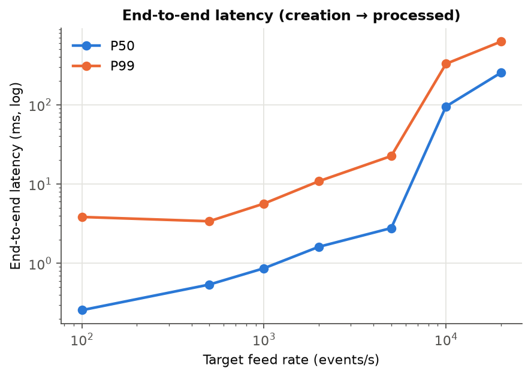

**Figure 8.5: End-to-end latency (creation → processed) under load**

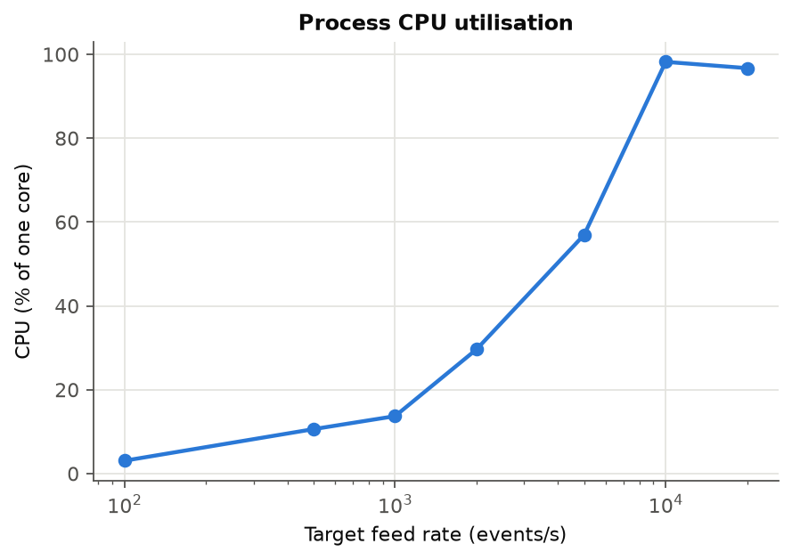

**Figure 8.6: Process CPU utilisation under load**

**Observations.**
1. **Linear scaling up to 5,000 events/s.** The achieved rate matched the target within 0.1% up to 5,000 events/s, with no drops and complete recordings.
2. **Per-event latency *falls* as load rises,** from a 25.7 µs median at 100 events/s to 9.3 µs at 5,000. At low rates each event arrives at a "cold" processor: CPU caches have been evicted and the CPU is in a power-saving frequency state. At higher rates events arrive in bursts and run on a warm core. Tail latency improves the same way (P99 160 → 29 µs). This is why latency should be reported at the operating rate, not only under heavy load.
3. **The saturation point is about 8,500–8,800 events/s, limited by one CPU core.** Above 5,000 events/s, CPU use reaches about 98% of one core. The simulator and the processor share one Python event loop (and the interpreter lock), and generating an event (about 70 µs, Table 8.5) costs more than processing it (about 9 µs). At saturation, the generator's catch-up cap (0.25 s) limits how many events are created, so the *achieved rate* plateaus rather than drops appearing. That is why the dropped count stays at zero. End-to-end latency grows to hundreds of milliseconds as each 0.25-second batch waits to be processed.
4. **Memory is modest and bounded:** 107–154 MB, which fits within the 512 MB cloud instance.
5. **Persistence lag stayed between 1.5 and 2.5 s at the median** (P99 3–5.5 s) at every rate, set by the 5-second flush policy, with no effect on processing latency.
6. **Scaling path.** The ceiling is set by single-process CPU, not by the design. Separating the feed from the processors (a Kafka topic partitioned by symbol, one consumer per partition) would scale horizontally. The `EventBus` interface keeps this change local to one class.

## 8.8 Experiment D: Model Evaluation

**Setup.** The models are trained on the training split and evaluated once on the held-out test split (5–23 November 2026, 3,438 rows; class distribution SELL 20.5%, HOLD 59.3%, BUY 20.2%). Retraining XGBoost with the documented settings reproduced the saved production model exactly (probabilities identical to within 10⁻⁵).

**Table 8.7: Experiment D: model results on the test set**

| Model | Accuracy | Macro precision | Macro recall | **Macro-F1** | BUY/SELL coverage | Directional hit-rate (chance) | Log loss |
|---|---|---|---|---|---|---|---|
| Majority class (always HOLD) | **0.593** | 0.198 | 0.333 | 0.248 | 0% | – | – |
| Stratified random (50 seeds) | 0.451 | 0.334 | 0.334 | 0.333 | 36.7% | 20.4% (20.4%) | – |
| Momentum rule (5-bar return) | 0.502 | 0.382 | 0.380 | 0.380 | 36.1% | 25.2% (20.3%) | – |
| RSI rule (30/70) | 0.575 | **0.406** | 0.363 | 0.337 | 12.5% | **30.0%** (20.4%) | – |
| Logistic regression (balanced) | 0.465 | 0.394 | 0.396 | **0.391** | 49.2% | 25.4% (20.3%) | 1.084 |
| Random forest (balanced) | 0.424 | 0.394 | 0.397 | 0.381 | 60.0% | 24.5% (20.3%) | **1.076** |
| **XGBoost (PredictX)** | 0.438 | 0.400 | **0.405** | **0.390** | 57.7% | 25.6% (20.4%) | 1.085 |

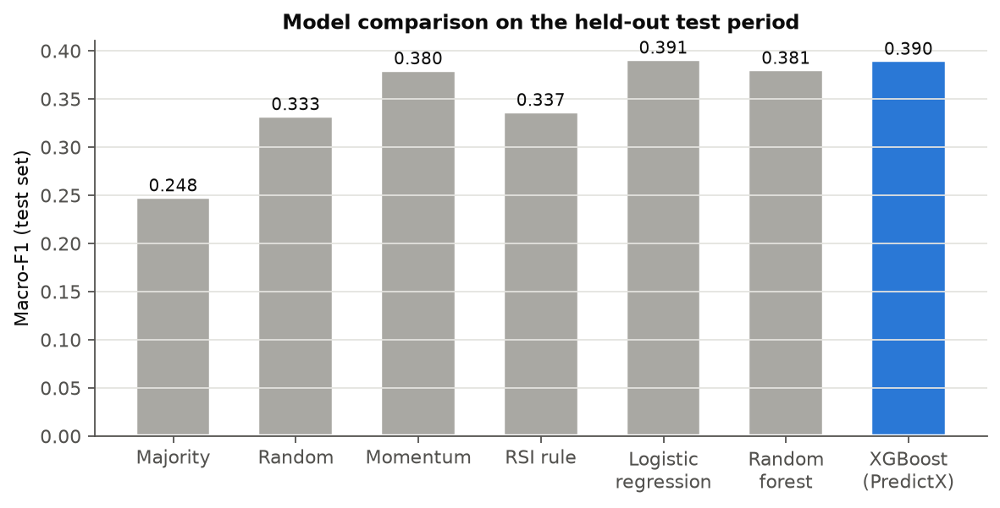

**Figure 8.7: Model comparison (macro-F1) on the held-out test period**

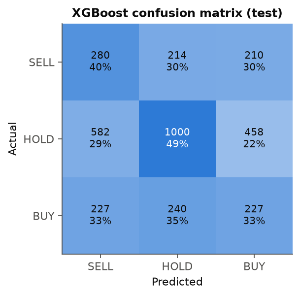

**Figure 8.8: XGBoost confusion matrix (counts and row-normalised recall)**

| Actual ↓ / Predicted → | SELL | HOLD | BUY |
|---|---|---|---|
| SELL (704) | **280** (39.8%) | 214 | 210 |
| HOLD (2,040) | 582 | **1,000** (49.0%) | 458 |
| BUY (694) | 227 | 240 | **227** (32.7%) |

**Table 8.8: Experiment D: XGBoost per-symbol results**

| Symbol | Test rows | Accuracy | Macro-F1 | Majority-class macro-F1 | Directional hit-rate |
|---|---|---|---|---|---|
| RELIANCE | 861 | 0.477 | 0.356 | 0.272 | 17.6% |
| TCS | 858 | 0.417 | 0.391 | 0.238 | 28.6% |
| INFY | 859 | 0.442 | **0.415** | 0.235 | **31.0%** |
| HDFCBANK | 860 | 0.416 | 0.359 | 0.246 | 22.8% |

**Table 8.9: Experiment D: confidence calibration (XGBoost, maximum class probability)**

| Confidence bin | Rows | Mean confidence | Observed accuracy |
|---|---|---|---|
| < 0.36 | 2,074 | 0.345 | 0.387 |
| 0.36 – 0.39 | 1,016 | 0.374 | 0.467 |
| 0.39 – 0.42 | 343 | 0.397 | 0.668 |
| 0.42 – 0.45 | 5 | 0.430 | 0.400 |

Expected calibration error (ECE) = 0.080. Signals above the NO TRADE threshold (0.351): coverage 28.9% of bars, precision 29.5%.

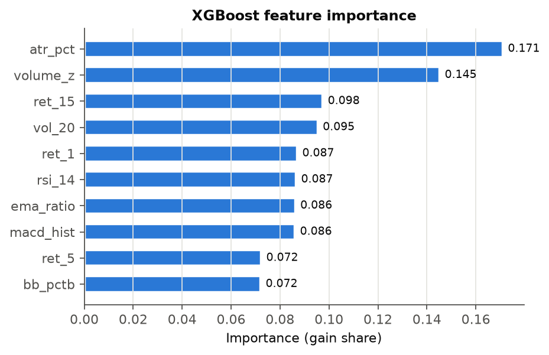

**Figure 8.9: XGBoost feature importance**

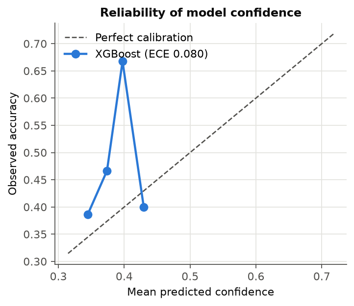

**Figure 8.10: Reliability of model confidence**

**Observations.**
1. **Accuracy is the wrong metric here.** The majority-class model scores the highest accuracy (59.3%) while never predicting a trade. Every useful model scores lower on accuracy because balanced weighting makes it predict BUY and SELL.
2. **There is a modest but real edge.** XGBoost's macro-F1 (0.390) is 57% above the majority baseline (0.248) and 17% above random (0.333). Its BUY/SELL hit-rate (25.6%) beats chance (20.4%) by 5.2 percentage points over about 1,980 directional calls.
3. **XGBoost is not better than logistic regression** (0.391), and a random forest is similar (0.381). With ten technical features on 5-minute bars, the learnable signal is weak and mostly linear. Early stopping at 10 trees points the same way. This is reported as found: the value of PredictX lies in the explanation pipeline and the baseline-aware evaluation, not in a superior model.
4. **The simple rules are competitive in parts.** The RSI rule has the highest directional precision (30.0%) but trades rarely (12.5% of bars). The momentum rule reaches a macro-F1 of 0.380 with no training at all.
5. **The edge varies by symbol:** strongest for INFY and TCS, and weakest for RELIANCE, where the directional hit-rate (17.6%) is *below* chance. A per-symbol deployment decision would be needed in practice.
6. **Confidence is informative but miscalibrated.** Accuracy rises from 39% to 67% across the bins, so higher confidence does mean more reliable predictions, but the probabilities are under-confident and compressed into 0.33–0.43. Raw probabilities must therefore not be shown as probabilities of profit. RiskGuard uses confidence only as a relative scale, through the edge over 1/3.
7. **The most important features are volatility-related** (ATR %, volume z-score, 20-bar volatility), ahead of momentum. The model mostly learns *when large moves are likely*, which helps separate HOLD from BUY/SELL more than it separates BUY from SELL.

## 8.9 Experiment E: Paper-Trading Simulation with Costs

**Setup.** As described in Section 6.11:
- test period from 5 November 2026 10:50 IST to 23 November 2026 14:50 IST: 12 trading days, 863 timestamps × 4 symbols;
- starting capital ₹10,00,000;
- signals at the bar close, fills at the next bar's open;
- round-trip costs of 0, 5, 10 and 20 bps.

**Table 8.10: Experiment E: trading simulation by cost level**

| Strategy | Trades | Return 0 bps | Return 5 bps | **Return 10 bps** | Return 20 bps | Sharpe (10 bps) | Max DD (10 bps) | Win rate (10 bps) | Avg trade, gross |
|---|---|---|---|---|---|---|---|---|---|
| Buy & hold (25% per stock) | 4 | +1.60% | +1.55% | **+1.50%** | +1.40% | 1.89 | −3.52% | 50.0% | +1.61% |
| XGBoost raw (BUY view) | 294 | +2.14% | −0.82% | −3.67% | −9.16% | −7.48 | −4.43% | 38.4% | +0.036% |
| **XGBoost + RiskGuard** | 223 | **+2.43%** | **+0.20%** | −1.97% | −6.18% | −7.14 | −3.13% | 41.3% | +0.052% |
| Momentum rule | 194 | +0.68% | −1.25% | −3.14% | −6.82% | −8.14 | −3.67% | 38.7% | +0.018% |
| RSI rule (< 30) | 51 | +0.75% | +0.24% | −0.27% | −1.28% | −1.97 | −0.86% | 47.1% | +0.073% |
| Random entries (100 seeds, mean) | 387 | +0.80% | −3.02% | −6.68% | −13.61% | −14.26 | – | – | – |
| Random, 5th–95th percentile | | −0.86% to +2.41% | −4.52% to −1.47% | −8.06% to −5.25% | −14.95% to −12.14% | | | | |

Without costs, XGBoost + RiskGuard had a Sharpe ratio of 8.88 and a maximum drawdown of −0.53%. Its exits were 76 stop-losses, 58 targets and 89 time exits.

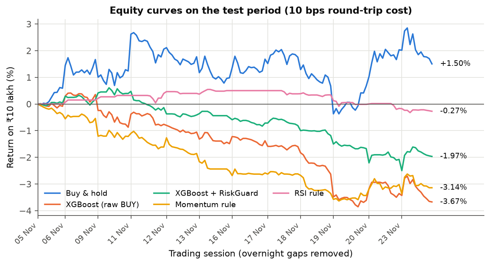

**Figure 8.11: Equity curves on the test period at 10 bps round-trip cost**

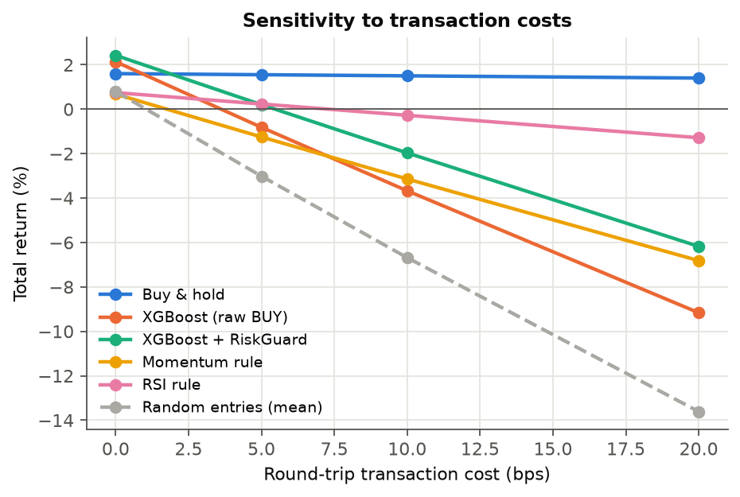

**Figure 8.12: Sensitivity of strategy returns to transaction costs**

**Observations.**
1. **RiskGuard adds value to the same signals.** Compared with raw XGBoost entries, it gave higher returns at every cost level (+2.43% vs +2.14% at zero cost, and +1.70 percentage points at 10 bps). It took fewer trades (223 vs 294), reduced the zero-cost maximum drawdown from −1.59% to −0.53% and roughly doubled the Sharpe ratio. Stops and targets resolved 60% of trades before the time exit.
2. **The model's gross edge is real but small.** Average gross returns per trade were +3.6 bps (raw) and +5.2 bps (with RiskGuard), against about +1 bp for random entries. The zero-cost RiskGuard result (+2.43%) lies just above the 95th percentile of random entry (+2.41%), which is *weak* statistical evidence over only 12 trading days.
3. **Realistic costs eliminate it.** A round trip costs 5–10 bps, which equals or exceeds the gross edge per trade. At 10 bps, every active strategy lost money, while buy-and-hold made +1.50% in a rising market. This is the most important result of the evaluation, and it agrees with the literature's caution that strategies on short-horizon predictions must be judged after costs.
4. **Fewer, more selective trades degrade more slowly.** The RSI rule (51 trades) lost only 0.27% at 10 bps. Lowering trade frequency, or requiring the expected move to exceed the round-trip cost before entering, is the clearest improvement path.
5. **Sharpe ratios over 12 days are unreliable.** Annualising 863 bar-returns amplifies noise, so the Sharpe values (for example 8.9 or −7.1) should be read as relative rankings, not as achievable performance.
6. **Limitations:**
   - one short test period in a mostly rising market;
   - no market impact or queue-position modelling;
   - fills at the open of the next bar;
   - long-only strategies, by design.


## 8.10 Experiment F: Decision-Path Latency

**Method.** Each step of producing a signal and a risk verdict was timed in-process on the laptop: 300–20,000 calls per step after warm-up, using a 400-bar candle frame for RELIANCE.

**Table 8.11: Experiment F: decision-path latency**

| Step | P50 | P95 / P99 | Share of a full signal (P50) |
|---|---|---|---|
| Feature build over 400 bars (pandas) | 24.4 ms | – / 92.6 ms | ~51% |
| XGBoost `predict_proba`, 1 row (scikit-learn wrapper) | 5.47 ms | – / 46.3 ms | ~11% |
| XGBoost `inplace_predict`, 1 row (native booster) | **0.97 ms** | – / 3.4 ms | (alternative) |
| XGBoost per-feature contributions, 1 row | 7.04 ms | – / 12.2 ms | ~15% |
| **Full signal with explanation** (`Predictor.predict`) | **47.8 ms** | – / 176.9 ms | 100% |
| **RiskGuard `evaluate`** | **21.7 µs** | – / 136.6 µs | – |

**Observations.**
1. **RiskGuard is effectively free.** At about 22 µs, a pure-Python rule engine adds nothing noticeable to an order, so deterministic risk checks cost no performance.
2. **The signal path is dominated by overhead, not by the model.** Recomputing ten indicators over 400 bars in pandas takes half the time, and the scikit-learn wrapper is 5.6× slower than the native `inplace_predict` for a single row. Profiling has therefore found two concrete optimisations:
   - compute features incrementally on the last bar only;
   - call the booster directly.

   Together they would bring a signal to roughly 10 ms. This is the kind of profiling-led optimisation that should come before any C++ rewrite.
3. At about 48 ms, the full signal is well within the 200 ms server-side target (NF5), and signals are computed on request, not per event, so this cost never touches the 9–25 µs event path.

## 8.11 Experiment G: Cloud Deployment

**Method.**
- **Clients.** A local server (port 8011) and the production deployment on Render were each measured from the same laptop in Kolkata.
- **HTTP.** For each endpoint: 3 warm-up requests, then 50 sequential HTTPS requests on a keep-alive connection, after signing in as a guest.
- **WebSocket.** The arrival times of 41 messages on `/ws/market`.
- **In-cloud pipeline.** The production service's own StreamX metrics were read from `/api/monitor/metrics`.

**Table 8.12: Experiment G: client-observed API latency, local vs cloud (P50 / P95, ms)**

| Endpoint | Response size | Local P50 / P95 | Render cloud P50 / P95 | Cloud − local (P50) |
|---|---|---|---|---|
| `GET /api/health` | 0.3 KB | 3.5 / 5.3 | 160.4 / 184.1 | 157 |
| `GET /api/market/{s}/snapshot` | 0.4 KB | 3.7 / 5.5 | 161.0 / 196.0 | 157 |
| `GET /api/market/{s}/candles` (400) | 49 KB | 19.2 / 33.0 | 167.5 / 231.6 | 148 |
| `GET /api/predict/{s}` | 1.4 KB | 63.1 / 78.7 | 200.9 / 295.0 | 138 |
| `POST /api/risk/evaluate` | 1.9 KB | 89.6 / 276.0 | 200.8 / 289.8 | 111 |
| `GET /api/paper/portfolio` | 0.2 KB | 7.2 / 10.2 | 160.3 / 187.3 | 153 |

| Measurement | Local | Render cloud |
|---|---|---|
| First request (`/api/health`, service already awake) | 17 ms | 1,178 ms (TLS and connection setup, plus a possible wake-up) |
| WebSocket connect | 71 ms | 442 ms |
| `/ws/market` message interval (server sends every 250 ms) | P50 252 ms, mean 263 ms | P50 1.8 ms, mean 502 ms (messages arrive in bursts) |
| In-pipeline processing latency P50 / P95 / P99 | 19.1 / 38.9 / 104.4 µs (200 events/s) | **8.4 / 16.4 / 26.7 µs** (201 events/s) |
| In-pipeline end-to-end latency P50 / P99 | 0.36 / 7.3 ms | **0.07 / 0.96 ms** |
| Events processed / dropped (service uptime) | 3,146 / 0 (16 s) | 154,439 / 0 (773 s) |
| Events recorded to Parquet | 3,112 (+34 buffered) | 154,079 (+360 buffered) in 153 files |

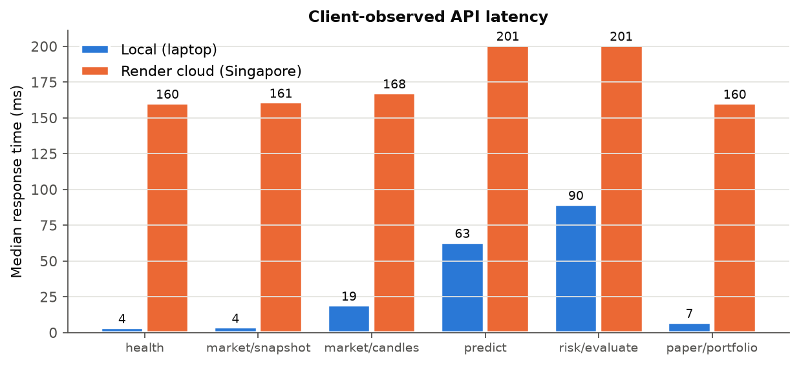

**Figure 8.13: Client-observed API latency: local vs Render cloud (median)**

**Observations.**
1. **The network sets the floor in the cloud.** The trivial health endpoint takes 160 ms from Kolkata to Singapore and back through Render's proxy. That is about 157 ms more than locally, and the same overhead appears on every endpoint. For a user interface this is acceptable. For latency-sensitive trading it is exactly why the literature emphasises colocation [1, 2, 6].
2. **The cloud server computes faster than the laptop.** Server-side work (cloud P50 minus the health baseline) is about 40 ms for a signal, against about 60 ms locally. The in-pipeline P50 is 8.4 µs in the cloud against 19 µs on the laptop at the same rate. The Linux container with uvloop also shows end-to-end latency about 5× lower than Windows with the Proactor event loop.
3. **WebSocket delivery through the proxy is bursty.** The server sends every 250 ms, but cloud messages arrived in groups (P50 gap 1.8 ms, mean gap 502 ms). This is consistent with proxy or TCP buffering and with CPU throttling on the free plan. The terminal handles this because each message is a full snapshot rather than a delta.
4. **Integrity held in the cloud too:** 154,439 events processed with zero drops over 13 minutes, and every event either recorded or still in the buffer.

## 8.12 Functional Testing

**Table 8.13: Functional test summary and defects found**

| Suite | Checks | Local | Production |
|---|---|---|---|
| Unit tests (pytest) | 17 | 17 / 17 pass | n/a |
| End-to-end checks (`e2e_check.py`) | 67 | 67 / 67 pass | 67 / 67 pass |
| Browser, desktop (6 screens + landing page) | manual | pass | pass |
| Browser, 390 px mobile width | manual | no horizontal overflow | no horizontal overflow |

The end-to-end suite verifies, among other things:
- a forged Google token is rejected with 401;
- every protected route returns 401 without a session;
- validation errors return 422;
- a full buy → partial sell → oversell (reduced) → close lifecycle in which **equity = cash + market value** and **the change in cash equals realised P&L**;
- complete isolation between two users' accounts;
- both WebSockets deliver messages, over WSS in production.

| # | Defect found | Found by | Root cause | Fix |
|---|---|---|---|---|
| 1 | Feed ran at ~8,000 events/s instead of 200 | API smoke test | Short asyncio sleeps on Windows return immediately (15.6 ms timer resolution) | Pace by real elapsed time (rate × Δt + carry) |
| 2 | Latency read 0 µs or ~1,000 µs | API smoke test | `time.time_ns()` resolution is about 1 ms on Windows | `time.perf_counter_ns()` |
| 3 | About 90% of signals were NO TRADE, and every BUY was rejected | Signal distribution analysis | Threshold and reward curve assumed confidence ≥ 0.4; the model outputs 0.34–0.43 | Threshold = validation median; reward scaled by the edge over 1/3 |
| 4 | Browser froze on the landing page | Browser test | Tailwind runtime re-scanned the DOM on every live update | Precompiled Tailwind CSS |
| 5 | Trade and portfolio screens overflowed on phones | Responsive test | Implicit grid tracks sized to their content | `grid-cols-1` + `min-width: 0` |
| 6 | Feed badge wrapped; price and change collided | Responsive test | Fixed-width text on narrow screens | Short badge on mobile, wrapping price row |
| 7 | Stale CSS/JS after a deploy | Responsive test | No cache headers | `Cache-Control: no-cache` for app files, 1 day for vendor files |
| 8 | Close-position clicks were lost | Browser automation | Table re-rendered every 3 s, replacing the buttons | Delegated click handler plus a double-click guard |
| 9 | Large latency values overflowed tiles | Visual check | Values always formatted in µs | Switch to ms above 1,000 µs |
| 10 | Sign-in screen appeared late | Visual check | Authentication started after the chart loaded | Authentication starts on page load |

## 8.13 Chapter Summary

| Objective | Evidence | Result |
|---|---|---|
| Event capture preserves detail | Exp. A | 100 ms snapshots hide 80–98% of events; event capture hides none |
| Persistence off the hot path | Exp. B | Async: P99 65 µs at 1,000 events/s; sync FULL: 60 events/s maximum |
| Throughput and latency | Exp. C | 5,000 events/s with P99 29 µs and no loss; saturates at about 8.8k events/s on one core |
| Model value vs baselines | Exp. D | Macro-F1 0.390 vs 0.248 (majority) / 0.333 (random); equal to logistic regression |
| Trading value after costs | Exp. E | RiskGuard improves the same signals at every cost level, but no active strategy beats buy-and-hold at a realistic 10 bps |
| Decision-path cost | Exp. F | RiskGuard 22 µs; full signal 48 ms, half of it feature recomputation |
| Cloud behaviour | Exp. G | ~160 ms network floor; cloud pipeline P50 8.4 µs; 154k events with no drops |
| Correctness | Tests | 17 unit + 67 end-to-end checks passing locally and in production |

<div style="page-break-after: always;"></div>

# CHAPTER 9: DISCUSSION, LIMITATIONS AND SECURITY

## 9.1 Discussion

**Event capture vs snapshots.** Experiment A confirms the survey's observation quantitatively. A snapshot pipeline loses information in proportion to λΔt, and no single interval suits every event rate. Event capture costs more storage, because every event is recorded, but Experiment B shows that it does not have to cost latency, as long as persistence is batched off the hot path.

**What latency means here.** The project reports four different latencies (state update, processing path, end to end, and client-observed), and they differ by about four orders of magnitude: microseconds, milliseconds, and around 160 ms over the network. A claim such as "TradeMind processes events in 9 µs" is true only for the state-update boundary. This is the main methodological lesson of Aquilina et al. [2], applied to the project's own measurements.

**Is the cloud appropriate?** For this workload, yes. One container handles thousands of events per second at microsecond processing latency, using under 160 MB of memory, at zero cost. The cloud adds about 160 ms of network latency for a user in Kolkata, which is irrelevant for a learning tool but would rule out any form of latency-sensitive trading. That would need colocation, as discussed in [1, 6]. The design scales by partitioning the event bus by symbol, not by tuning a single process.

**Does the AI add value?** Statistically, a little. The model beats the majority, random and momentum baselines on macro-F1 and directional precision, and its confidence ranks predictions well. However, it does not beat logistic regression, and its gross edge per trade (about 4–5 bps) is smaller than realistic costs. This is consistent with the difficulty of short-horizon prediction from public bar data alone, and it supports the original design principle that *a prediction must not directly trigger a trade*. The most valuable parts of PredictX in this prototype are its explanations (why the model leans one way) and its honest model card.

**Does RiskGuard add value?** Yes, measurably. Applied to the same signals, it raised returns at every cost level, cut the zero-cost drawdown by two thirds, and resolved 60% of trades through stops and targets, while costing about 22 µs per decision.

## 9.2 Limitations

1. **Simulated live feed.** The live stream is synthetic, although it is seeded from real prices and volatilities. Experiments A–C measure the *system* on that stream, so they do not show how a real NSE feed would behave (message mix, burstiness, sequence gaps).
2. **Data depth.** Training uses public 5-minute bars, not full-depth order-book events. Order-book imbalance is used live but is not a training feature, because no historical book data was available.
3. **Short evaluation window.** The test period is 12 trading days in a mostly rising market. The results could differ in other market conditions, and the strategy statistics have wide uncertainty.
4. **Trading-simulation realism.** Fills are at the next bar's open, with no market impact, queue position or partial fills. Strategies are long-only, and costs are a flat rate in basis points.
5. **Single-core laptop benchmarks.** Results depend on the CPU, the operating system (Windows timer behaviour) and the Python event loop. Absolute numbers will differ on other machines.
6. **Sentiment.** Sentiment uses illustrative sample headlines and a lexicon, and it is not part of the measured model performance.
7. **Free cloud tier.** The service sleeps when idle, has a shared CPU and loses accounts on restart. The cloud measurements represent this tier only.
8. **No exchange-grade claims.** There is no colocation, kernel bypass, hardware timestamping or real order routing. The prototype is not HFT infrastructure.

## 9.3 Security and Ethical Considerations

- **Credentials and secrets.** No secrets are in the repository: `.env`, the database and the key file are ignored by Git. Production secrets live in the platform's environment settings. A Render API key that was shared in a chat during development should be rotated after the project, and the deployment guide records this.
- **User data.** Only the Google profile fields needed for display are stored (ID, name, email, picture). Sessions are signed and HTTP-only, and each account is isolated, which the end-to-end tests verify.
- **Market data.** Only public historical data is used, for non-commercial education. Any live NSE data would need a licence from the exchange or an authorised vendor [9].
- **Honest presentation.**
  - The live feed is labelled SIMULATED on every screen.
  - Every signal carries a disclaimer.
  - Model confidence is never presented as a probability of profit.
  - Accuracy figures are always shown with their baselines.
  - Paper trades are clearly virtual.
- **Regulation.** Any extension to real-money trading or advice would require separate legal and regulatory assessment, including SEBI rules on investment advice and algorithmic trading and broker API terms. That is outside this project's scope.

## 9.4 Chapter Summary

The prototype meets its engineering objectives, with measured evidence. Its predictive and trading results are modest and are reported with their limitations. The strongest conclusions concern system design (event capture, asynchronous persistence and deterministic risk control), not market prediction.

<div style="page-break-after: always;"></div>

# CHAPTER 10: CONCLUSION AND FUTURE SCOPE

## 10.1 Conclusion

TradeMind AI was designed, built, deployed and evaluated as a complete cloud-based market-intelligence pipeline:

- **StreamX** captures every event with three nanosecond timestamps, keeps the hot path in memory and records asynchronously. On a two-core laptop it sustained 5,000 events/s with a P99 state-update latency of 29 µs and no data loss, and it saturated at about 8,800 events/s on one CPU core. In the cloud it ran at a median of 8.4 µs. Experiments showed that fixed 100 ms snapshots would hide 80–98% of the same events, and that synchronous fully durable writes would cut throughput to about 60 events/s.
- **PredictX** trains an explainable XGBoost model on about 17,000 real NSE 5-minute bars with a purged chronological split. Its macro-F1 is 0.390 against 0.248 for the majority-class baseline, and its directional hit-rate is 25.6% against 20.4% chance. It matches, but does not beat, logistic regression.
- **RiskGuard** turns every signal into a sized, bounded and explained decision in about 22 µs, and measurably improves the outcome of the same signals.
- The **paper-trading platform**, with Google sign-in, is publicly deployed with continuous delivery and has passed 17 unit tests and 67 end-to-end checks in production.

The project's value lies in demonstrating a measurable, reproducible data-to-decision pipeline and reporting it honestly, including the finding that the model's small edge does not survive realistic transaction costs. It does not claim institutional HFT performance.

## 10.2 Future Scope

1. **Licensed real-time data:** replace the simulator with an authorised NSE feed (Level 2 or tick-by-tick) through the existing `EventBus` interface, and add sequence-gap detection.
2. **Horizontal scaling:** implement `KafkaEventBus` on Amazon MSK, partitioned by symbol with one processor per partition, then repeat Experiment C beyond the single-core limit.
3. **Profiling-led optimisation:** incremental features and a native booster call (Experiment F points to about a 5× faster signal path). Consider C++ components only after profiling.
4. **Order-book models:** collect full-depth data and evaluate DeepLOB-style CNN-LSTM models [3] against the XGBoost baseline.
5. **Cost-aware decisions:** require the expected move to exceed round-trip costs, train directly on net-of-cost labels, and add probability calibration (isotonic or Platt scaling) and drift monitoring.
6. **Real news sentiment:** FinBERT on a time-aligned, licensed news feed, evaluated as a feature rather than a heuristic adjustment.
7. **Back-testing and replay:** historical replay of recorded Parquet sessions at 1×, 10× or 100× speed; walk-forward evaluation over several months and market regimes; more realistic fills with partial fills and queue position.
8. **Persistent cloud storage:** PostgreSQL (RDS) for accounts and S3 for the event archive, so state survives redeployments.
9. **Operations:** metrics export (Prometheus or OpenTelemetry), alerting, autoscaling, and backup and disaster recovery.

## 10.3 Final Remarks

A transparent pipeline, measured at every boundary and compared against baselines, is more credible and more useful to learners than an impressive but unverifiable accuracy figure. That has been the guiding principle of this project.

<div style="page-break-after: always;"></div>

# APPENDICES

## Appendix 1: Dataset and Event Schema

**Historical bars** (`backend/data/raw/<SYMBOL>_5m.csv`):

| Column | Type | Description |
|---|---|---|
| `time` | int | Bar open time, Unix seconds (UTC) |
| `open`, `high`, `low`, `close` | float | Prices in ₹ |
| `volume` | int | Shares traded in the bar (0 for the opening auction bar in some rows) |

Sample rows (RELIANCE):

```text
time,open,high,low,close,volume
1787802300,1304.30,1308.20,1303.00,1303.80,0
1787802600,1303.70,1305.30,1303.00,1304.60,70473
```

**Recorded events** (`backend/data/events/session-*/part-*.parquet`): `seq, symbol, price, qty, bid, ask, bid_qty, ask_qty, created_ns, ingest_ns, processed_ns`. The schema is given in Table 5.1.

**Data source note:** Yahoo Finance historical data, obtained with `yfinance`, is used for non-commercial educational research. The live stream is synthetic.

## Appendix 2: API Documentation (examples)

`GET /api/predict/RELIANCE`:

```json
{
  "symbol": "RELIANCE", "signal": "NO_TRADE", "model_view": "SELL",
  "confidence": 0.3203, "raw_confidence": 0.3703, "threshold": 0.3513,
  "probabilities": {"SELL": 0.3703, "HOLD": 0.3021, "BUY": 0.3276},
  "market_pressure": "Positive", "imbalance": 0.53,
  "sentiment": {"score": 0.5, "label": "Positive"}, "annualised_volatility": 0.187,
  "top_factors": [{"feature": "atr_pct", "value": 0.0032, "contribution": 0.217,
                   "text": "Average true range is 0.32% of price, which supports SELL"}],
  "explanation": "The model leans SELL (37% raw probability) mainly because ...",
  "horizon": "next 6 bars (~30 simulated minutes)", "model_version": "xgb-20261123-2022",
  "disclaimer": "Educational prototype. Confidence is not a probability of profit. Not financial advice."
}
```

`POST /api/risk/evaluate` with body `{"symbol": "RELIANCE", "side": "BUY", "qty": 144}` returns `{"verdict": …, "signal": …}`, where:

```json
"verdict": {
  "status": "REDUCED", "requested_qty": 144, "approved_qty": 143, "entry": 1389.15,
  "stop_loss": 1382.55, "target": 1405.92, "risk_reward": 2.54, "risk_amount": 944.0,
  "risk_level": "MODERATE", "exposure_symbol_after": 0.199, "exposure_total_after": 0.199,
  "reasons": ["Quantity reduced from 144 to 143: limited by single-stock cap (20%)",
              "Stop 1382.55 (1.5x ATR), target 1405.92, R:R 2.54"]
}
```

Error responses: `401 {"detail": "Not signed in"}`; `404 {"detail": "Unknown symbol XYZ"}`; `422` (Pydantic validation details). The full interactive specification is at `/docs`.

## Appendix 3: Algorithms and Pseudocode

Algorithms 1–3 are in Sections 6.9–6.10. The simulator update is Equation 6.1. The training procedure is:

```text
Algorithm 4: PredictX training
for each symbol:
    bars ← load_history(symbol)                       # real NSE 5-minute bars
    X ← build_features(bars); y ← make_labels(bars, H=6, θ=0.25%)
    drop rows with NaN; split 68/12/20 in time order; purge H rows before each boundary
concatenate the symbols
model ← XGBClassifier(depth 4, lr 0.05, ≤ 400 trees, balanced weights, early stop 40 on val log loss)
threshold ← clip(median(max_proba(val)), 0.34, 0.65)
evaluate once on test; save the model and metrics.json (the model card)
```

## Appendix 4: Experimental Configurations

| Parameter | Value |
|---|---|
| Random seeds | Simulator 42 (A: 11; drain: 7); XGBoost 42; random baselines 0–49 (D), 0–99 (E) |
| Warm-up / window | 2 s / 10 s (B, C); 30 s and 20 s capture (A) |
| Trials | 3 per rate (C); 3 repeats, median (B drain) |
| Bus capacity | 100,000 events (10,000,000 in A, so that nothing is dropped) |
| Recorder | Flush every 5 s or 20,000 rows; Snappy Parquet; background thread |
| Metrics window | All events in the measurement window (benchmarks); last 10,000 (live monitor) |
| Model | `backend/models/xgb_model.json`, version `xgb-20261123-2022`, threshold 0.3513 |
| Costs (E) | 0 / 5 / 10 / 20 bps round trip, applied half per side |
| API test (G) | 3 warm-up + 50 sequential requests per endpoint, keep-alive HTTPS; 41 WebSocket messages |
| Raw results | `thesis/benchmarks/results/{environment, A_capture_interval, B_persistence, C_load, D_model, E_trading, F_decision_latency, G_api}.json` |

## Appendix 5: Screenshots

Insert genuine screenshots captured from the live application (https://trademind-ai-ujm6.onrender.com), each with a caption:

1. Landing page (hero section with the live price, signal and latency card)
2. Sign-in gate (Google button and guest option)
3. Market screen (chart, order book, imbalance gauge, SIMULATED badge)
4. AI Signals screen (signal card, factors, explanation, model card)
5. Paper Trade screen showing a **REDUCED** or **REJECTED** verdict with reasons, then an **APPROVED** order
6. Portfolio & Risk screen (equity curve, exposure against limits)
7. StreamX Monitor at 200 and at 3,000 events/s (throughput chart, P50/P95/P99, histogram)
8. Architecture screen
9. Render dashboard showing the deployment and the health check
10. Terminal output of `pytest` (17 passed) and `e2e_check` (67/67)

## Appendix 6: Team Contribution

*Fill in truthfully. Each member's actual responsibilities only.*

| Member | Roll number | Responsibilities |
|---|---|---|
| [STUDENT NAME 1] | [ROLL NUMBER] | [e.g. StreamX, benchmarks, cloud deployment] |
| [STUDENT NAME 2] | [ROLL NUMBER] | [e.g. PredictX data, features, model evaluation] |
| [STUDENT NAME 3] | [ROLL NUMBER] | [e.g. RiskGuard, paper trading, frontend, testing, documentation] |

## Appendix 7: Reproducing the Results

From the repository root, on Windows, with the backend virtual environment:

```powershell
cd backend; python -m venv .venv; .\.venv\Scripts\pip install -r requirements.txt matplotlib psutil; cd ..
backend\.venv\Scripts\python.exe -m pytest backend\tests -q              # 17 unit tests
backend\.venv\Scripts\python.exe thesis\benchmarks\bench_stream.py       # env + Experiments A, B, C (~8 min)
backend\.venv\Scripts\python.exe thesis\benchmarks\bench_model.py        # Experiments D, E, F (~3 min)
backend\.venv\Scripts\python.exe thesis\benchmarks\bench_api.py          # Experiment G (local + cloud)
backend\.venv\Scripts\python.exe thesis\benchmarks\make_figures.py       # figures -> thesis/figures/
```

Stop any running TradeMind server before benchmarking. Absolute timings vary by machine; the relative comparisons are the result.

<div style="page-break-after: always;"></div>

# REFERENCES

[1] Budish, E., Cramton, P. and Shim, J. (2015) 'The High-Frequency Trading Arms Race: Frequent Batch Auctions as a Market Design Response', *The Quarterly Journal of Economics*, 130(4), pp. 1547–1621. https://doi.org/10.1093/qje/qjv027

[2] Aquilina, M., Budish, E. and O'Neill, P. (2022) 'Quantifying the High-Frequency Trading "Arms Race"', *The Quarterly Journal of Economics*, 137(1), pp. 493–564. https://doi.org/10.1093/qje/qjab032

[3] Zhang, Z., Zohren, S. and Roberts, S. (2019) 'DeepLOB: Deep Convolutional Neural Networks for Limit Order Books', *IEEE Transactions on Signal Processing*, 67(11), pp. 3001–3012. https://doi.org/10.1109/TSP.2019.2907260

[4] Chen, T. and Guestrin, C. (2016) 'XGBoost: A Scalable Tree Boosting System', in *Proceedings of the 22nd ACM SIGKDD International Conference on Knowledge Discovery and Data Mining*, pp. 785–794. https://doi.org/10.1145/2939672.2939785

[5] Lundberg, S. M. and Lee, S.-I. (2017) 'A Unified Approach to Interpreting Model Predictions', in *Advances in Neural Information Processing Systems 30 (NeurIPS 2017)*, pp. 4765–4774.

[6] Amazon Web Services (2025) 'Optimize tick-to-trade latency for digital assets exchanges and trading platforms on AWS', *AWS Web3 Blog*, 24 July. https://aws.amazon.com/blogs/web3/optimize-tick-to-trade-latency-for-digital-assets-exchanges-and-trading-platforms-on-aws/

[7] Apache Software Foundation (n.d.) *Apache Kafka Documentation*. https://kafka.apache.org/documentation/

[8] Apache Software Foundation (n.d.) *Apache Parquet Documentation*. https://parquet.apache.org/docs/

[9] National Stock Exchange of India (n.d.) *Paid Real Time Data*. NSE Data & Analytics. https://www.nseindia.com/market-data/real-time-data-subscription

[10] López de Prado, M. (2018) *Advances in Financial Machine Learning*. Hoboken, NJ: Wiley. (Chapter 7: cross-validation in finance, purging and embargo.)

[11] Wilder, J. W. (1978) *New Concepts in Technical Trading Systems*. Greensboro, NC: Trend Research. (RSI and ATR.)

[12] Pedregosa, F. *et al.* (2011) 'Scikit-learn: Machine Learning in Python', *Journal of Machine Learning Research*, 12, pp. 2825–2830.

[13] Ramírez, S. (n.d.) *FastAPI Documentation*. https://fastapi.tiangolo.com/

> *Verify every reference and access date before submission and follow any department-specific citation style. References [5], [10]–[13] were added for methods used in this report.*
